# CGS (Catgirl Synth)

Ken Stone's CGS designs drawn in the Serge panel style. These are not Serge modules, so they sit apart from the
Serge eras and carry a CGS credit instead of the "serge" mark.

<!-- gallery:start (generated by tools/make_site.py) -->
## Panels

Click a picture for the full-size PNG. **SVG** is the artwork, **Drill** the 1:1 drill template, **Build** the module's build page. The same gallery is on the [website](https://computerstaat.github.io/Serge-Synthesizer-Panel-art-and-design-files/panels.html).

### Panels (74)

<table>
<tr>
<td align="center" valign="bottom"><a href="Images/8_Stage_Programmer_Sequencer.png">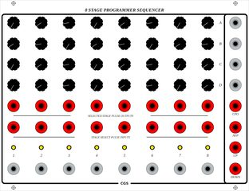</a> <b>8 Stage Programmer Sequencer</b> <a href="Vector%20Graphics/8_Stage_Programmer_Sequencer.svg">SVG</a> · <a href="Drill%20Templates/8_Stage_Programmer_Sequencer.pdf">Drill</a></td>
<td align="center" valign="bottom"><a href="Images/ASR_HumanComparator.png">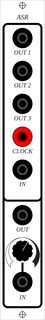</a> <b>ASR HumanComparator</b> <a href="Vector%20Graphics/ASR_HumanComparator.svg">SVG</a> · <a href="Drill%20Templates/ASR_HumanComparator.pdf">Drill</a></td>
<td align="center" valign="bottom"><a href="Images/Adapters_Catgirl.png">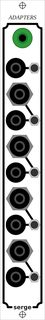</a> <b>Adapters Catgirl</b> <a href="Vector%20Graphics/Adapters_Catgirl.svg">SVG</a> · <a href="Drill%20Templates/Adapters_Catgirl.pdf">Drill</a></td>
<td align="center" valign="bottom"><a href="Images/Audio_Mixer_Catgirl.png">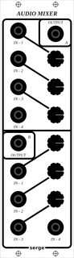</a> <b>Audio Mixer Catgirl</b> <a href="Vector%20Graphics/Audio_Mixer_Catgirl.svg">SVG</a> · <a href="Drill%20Templates/Audio_Mixer_Catgirl.pdf">Drill</a></td>
<td align="center" valign="bottom"><a href="Images/Audio_Mixer_Paperface.png">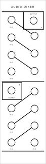</a> <b>Audio Mixer Paperface</b> <a href="Vector%20Graphics/Audio_Mixer_Paperface.svg">SVG</a> · <a href="Drill%20Templates/Audio_Mixer_Paperface.pdf">Drill</a></td>
</tr>
<tr>
<td align="center" valign="bottom"><a href="Images/Band_Pass_Filters_Paperface.png">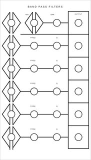</a> <b>Band Pass Filters Paperface</b> <a href="Vector%20Graphics/Band_Pass_Filters_Paperface.svg">SVG</a> · <a href="Drill%20Templates/Band_Pass_Filters_Paperface.pdf">Drill</a></td>
<td align="center" valign="bottom"> <b>Boolean Logic 1in</b> <a href="Vector%20Graphics/Boolean_Logic_1in.svg">SVG</a> · <a href="Drill%20Templates/Boolean_Logic_1in.pdf">Drill</a></td>
<td align="center" valign="bottom"><a href="Images/CGS-Custom.png">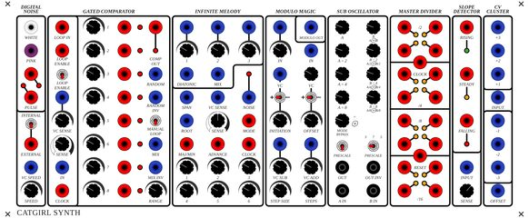</a> <b>CGS-Custom</b> <a href="Vector%20Graphics/CGS-Custom.svg">SVG</a> · <a href="Drill%20Templates/CGS-Custom.pdf">Drill</a></td>
<td align="center" valign="bottom"> <b>CV Cluster</b> <a href="Vector%20Graphics/CV_Cluster.svg">SVG</a> · <a href="Drill%20Templates/CV_Cluster.pdf">Drill</a></td>
<td align="center" valign="bottom"><a href="Images/Catgirl_Panel_DTG_Drums_LPG_Outputs.png">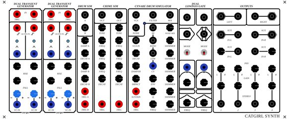</a> <b>Catgirl Panel DTG Drums LPG Outputs</b> <a href="Vector%20Graphics/Catgirl_Panel_DTG_Drums_LPG_Outputs.svg">SVG</a> · <a href="Drill%20Templates/Catgirl_Panel_DTG_Drums_LPG_Outputs.pdf">Drill</a></td>
</tr>
<tr>
<td align="center" valign="bottom"><a href="Images/Catgirl_Panel_Paperface_Oscillators_Comparator_Filter_KEG_Gate.png">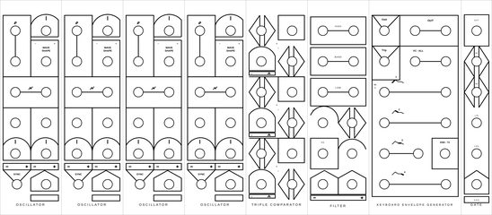</a> <b>Catgirl Panel Paperface Oscillators Comparator Filter KEG Gate</b> <a href="Vector%20Graphics/Catgirl_Panel_Paperface_Oscillators_Comparator_Filter_KEG_Gate.svg">SVG</a> · <a href="Drill%20Templates/Catgirl_Panel_Paperface_Oscillators_Comparator_Filter_KEG_Gate.pdf">Drill</a></td>
<td align="center" valign="bottom"><a href="Images/Catgirl_Panel_Paperface_Send_Receive_BPF_Phaser_Mixer_Ring_Reverb_Outputs.png">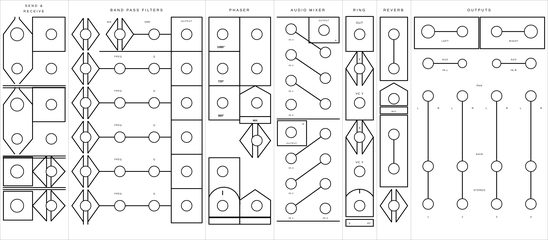</a> <b>Catgirl Panel Paperface Send Receive BPF Phaser Mixer Ring Reverb Outputs</b> <a href="Vector%20Graphics/Catgirl_Panel_Paperface_Send_Receive_BPF_Phaser_Mixer_Ring_Reverb_Outputs.svg">SVG</a> · <a href="Drill%20Templates/Catgirl_Panel_Paperface_Send_Receive_BPF_Phaser_Mixer_Ring_Reverb_Outputs.pdf">Drill</a></td>
<td align="center" valign="bottom"><a href="Images/Catgirl_Panel_Sequencers_Logic_Dividers.png">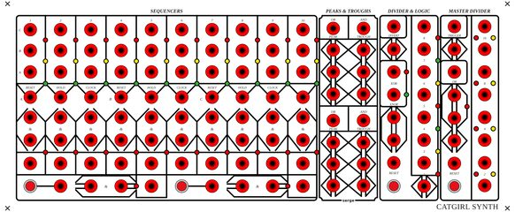</a> <b>Catgirl Panel Sequencers Logic Dividers</b> <a href="Vector%20Graphics/Catgirl_Panel_Sequencers_Logic_Dividers.svg">SVG</a> · <a href="Drill%20Templates/Catgirl_Panel_Sequencers_Logic_Dividers.pdf">Drill</a></td>
<td align="center" valign="bottom"><a href="Images/Catgirl_Panel_Switches_Logic_LFO.png">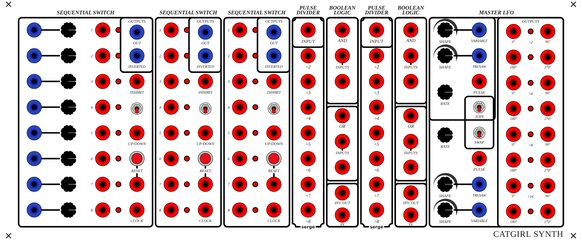</a> <b>Catgirl Panel Switches Logic LFO</b> <a href="Vector%20Graphics/Catgirl_Panel_Switches_Logic_LFO.svg">SVG</a> · <a href="Drill%20Templates/Catgirl_Panel_Switches_Logic_LFO.pdf">Drill</a></td>
<td align="center" valign="bottom"><a href="Images/Catgirl_Panel_Touch_Programmer_Sequencer.png">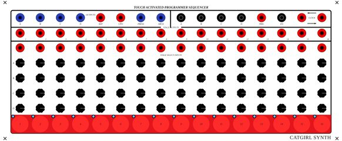</a> <b>Catgirl Panel Touch Programmer Sequencer</b> <a href="Vector%20Graphics/Catgirl_Panel_Touch_Programmer_Sequencer.svg">SVG</a> · <a href="Drill%20Templates/Catgirl_Panel_Touch_Programmer_Sequencer.pdf">Drill</a></td>
</tr>
<tr>
<td align="center" valign="bottom"><a href="Images/Catgirl_Panel_VCOs_DUSG_Smooth_VCA_VCF_Stereo_Mixer.png">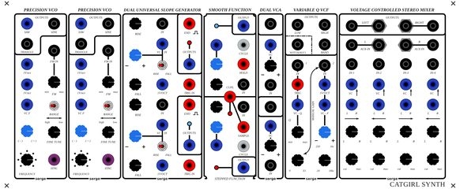</a> <b>Catgirl Panel VCOs DUSG Smooth VCA VCF Stereo Mixer</b> <a href="Vector%20Graphics/Catgirl_Panel_VCOs_DUSG_Smooth_VCA_VCF_Stereo_Mixer.svg">SVG</a> · <a href="Drill%20Templates/Catgirl_Panel_VCOs_DUSG_Smooth_VCA_VCF_Stereo_Mixer.pdf">Drill</a></td>
<td align="center" valign="bottom"><a href="Images/Catgirl_Panel_VCOs_Wave_Multipliers_DTG_VCF_Audio_Mixer.png">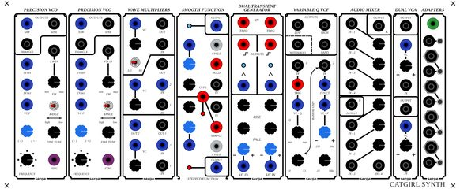</a> <b>Catgirl Panel VCOs Wave Multipliers DTG VCF Audio Mixer</b> <a href="Vector%20Graphics/Catgirl_Panel_VCOs_Wave_Multipliers_DTG_VCF_Audio_Mixer.svg">SVG</a> · <a href="Drill%20Templates/Catgirl_Panel_VCOs_Wave_Multipliers_DTG_VCF_Audio_Mixer.pdf">Drill</a></td>
<td align="center" valign="bottom"><a href="Images/Chime_Sim.png">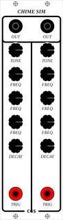</a> <b>Chime Sim</b> <a href="Vector%20Graphics/Chime_Sim.svg">SVG</a> · <a href="Drill%20Templates/Chime_Sim.pdf">Drill</a></td>
<td align="center" valign="bottom"><a href="Images/Compact_VCO.png">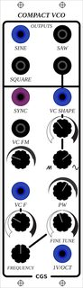</a> <b>Compact VCO</b> <a href="Vector%20Graphics/Compact_VCO.svg">SVG</a> · <a href="Drill%20Templates/Compact_VCO.pdf">Drill</a></td>
<td align="center" valign="bottom"><a href="Images/Cynare_Drum_Simulator.png">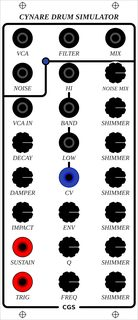</a> <b>Cynare Drum Simulator</b> <a href="Vector%20Graphics/Cynare_Drum_Simulator.svg">SVG</a> · <a href="Drill%20Templates/Cynare_Drum_Simulator.pdf">Drill</a></td>
</tr>
<tr>
<td align="center" valign="bottom"> <b>Digital Noise</b> <a href="Vector%20Graphics/Digital_Noise.svg">SVG</a> · <a href="Drill%20Templates/Digital_Noise.pdf">Drill</a></td>
<td align="center" valign="bottom"> <b>Digital Noise HumanComparator</b> <a href="Vector%20Graphics/Digital_Noise_HumanComparator.svg">SVG</a> · <a href="Drill%20Templates/Digital_Noise_HumanComparator.pdf">Drill</a></td>
<td align="center" valign="bottom"><a href="Images/Divider_and_Logic.png">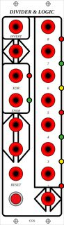</a> <b>Divider and Logic</b> <a href="Vector%20Graphics/Divider_and_Logic.svg">SVG</a> · <a href="Drill%20Templates/Divider_and_Logic.pdf">Drill</a></td>
<td align="center" valign="bottom"> <b>Drum Sim</b> <a href="Vector%20Graphics/Drum_Sim.svg">SVG</a> · <a href="Drill%20Templates/Drum_Sim.pdf">Drill</a></td>
<td align="center" valign="bottom"><a href="Images/Dual_CMOS_Filter.png">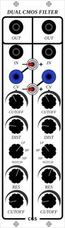</a> <b>Dual CMOS Filter</b> <a href="Vector%20Graphics/Dual_CMOS_Filter.svg">SVG</a> · <a href="Drill%20Templates/Dual_CMOS_Filter.pdf">Drill</a></td>
</tr>
<tr>
<td align="center" valign="bottom"><a href="Images/Dual_Lowpass_Gate.png">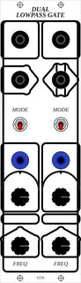</a> <b>Dual Lowpass Gate</b> <a href="Vector%20Graphics/Dual_Lowpass_Gate.svg">SVG</a> · <a href="Drill%20Templates/Dual_Lowpass_Gate.pdf">Drill</a></td>
<td align="center" valign="bottom"><a href="Images/Dual_Processor_HumanComparator.png">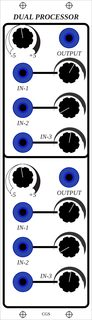</a> <b>Dual Processor HumanComparator</b> <a href="Vector%20Graphics/Dual_Processor_HumanComparator.svg">SVG</a> · <a href="Drill%20Templates/Dual_Processor_HumanComparator.pdf">Drill</a></td>
<td align="center" valign="bottom"><a href="Images/Dual_Transient_Generator_Catgirl.png">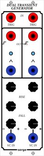</a> <b>Dual Transient Generator Catgirl</b> <a href="Vector%20Graphics/Dual_Transient_Generator_Catgirl.svg">SVG</a> · <a href="Drill%20Templates/Dual_Transient_Generator_Catgirl.pdf">Drill</a></td>
<td align="center" valign="bottom"><a href="Images/Dual_Universal_Slope_Generator_Catgirl.png">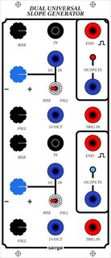</a> <b>Dual Universal Slope Generator Catgirl</b> <a href="Vector%20Graphics/Dual_Universal_Slope_Generator_Catgirl.svg">SVG</a> · <a href="Drill%20Templates/Dual_Universal_Slope_Generator_Catgirl.pdf">Drill</a></td>
<td align="center" valign="bottom"><a href="Images/Dual_Universal_Slope_Generator_HumanComparator.png">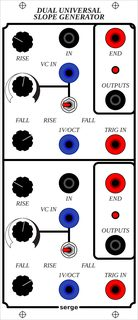</a> <b>Dual Universal Slope Generator HumanComparator</b> <a href="Vector%20Graphics/Dual_Universal_Slope_Generator_HumanComparator.svg">SVG</a> · <a href="Drill%20Templates/Dual_Universal_Slope_Generator_HumanComparator.pdf">Drill</a> · <a href="https://computerstaat.github.io/Serge-Synthesizer-Panel-art-and-design-files/Modules/dual-universal-slope-generator.html">Build</a></td>
</tr>
<tr>
<td align="center" valign="bottom"> <b>Dual VCA Catgirl</b> <a href="Vector%20Graphics/Dual_VCA_Catgirl.svg">SVG</a> · <a href="Drill%20Templates/Dual_VCA_Catgirl.pdf">Drill</a></td>
<td align="center" valign="bottom"><a href="Images/Dual_VCA_HumanComparator.png">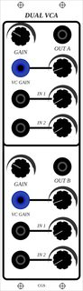</a> <b>Dual VCA HumanComparator</b> <a href="Vector%20Graphics/Dual_VCA_HumanComparator.svg">SVG</a> · <a href="Drill%20Templates/Dual_VCA_HumanComparator.pdf">Drill</a></td>
<td align="center" valign="bottom"><a href="Images/Extended_ADSR_HumanComparator.png">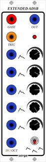</a> <b>Extended ADSR HumanComparator</b> <a href="Vector%20Graphics/Extended_ADSR_HumanComparator.svg">SVG</a> · <a href="Drill%20Templates/Extended_ADSR_HumanComparator.pdf">Drill</a> · <a href="https://computerstaat.github.io/Serge-Synthesizer-Panel-art-and-design-files/Modules/extended-adsr.html">Build</a></td>
<td align="center" valign="bottom"><a href="Images/Extended_Function_VCO.png">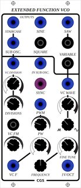</a> <b>Extended Function VCO</b> <a href="Vector%20Graphics/Extended_Function_VCO.svg">SVG</a> · <a href="Drill%20Templates/Extended_Function_VCO.pdf">Drill</a></td>
<td align="center" valign="bottom"><a href="Images/Gated_Comparator.png">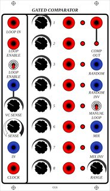</a> <b>Gated Comparator</b> <a href="Vector%20Graphics/Gated_Comparator.svg">SVG</a> · <a href="Drill%20Templates/Gated_Comparator.pdf">Drill</a></td>
</tr>
<tr>
<td align="center" valign="bottom"><a href="Images/HumanComparator_Panel_1.png">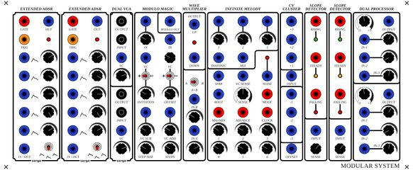</a> <b>HumanComparator Panel 1</b> <a href="Vector%20Graphics/HumanComparator_Panel_1.svg">SVG</a> · <a href="Drill%20Templates/HumanComparator_Panel_1.pdf">Drill</a></td>
<td align="center" valign="bottom"><a href="Images/HumanComparator_Panel_2.png">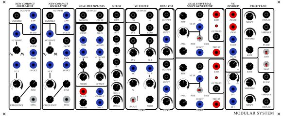</a> <b>HumanComparator Panel 2</b> <a href="Vector%20Graphics/HumanComparator_Panel_2.svg">SVG</a> · <a href="Drill%20Templates/HumanComparator_Panel_2.pdf">Drill</a></td>
<td align="center" valign="bottom"><a href="Images/HumanComparator_Panel_3.png">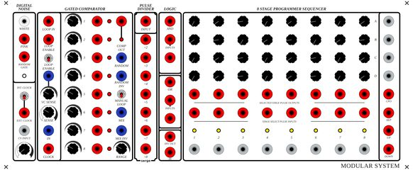</a> <b>HumanComparator Panel 3</b> <a href="Vector%20Graphics/HumanComparator_Panel_3.svg">SVG</a> · <a href="Drill%20Templates/HumanComparator_Panel_3.pdf">Drill</a></td>
<td align="center" valign="bottom"><a href="Images/HumanComparator_Panel_4.png">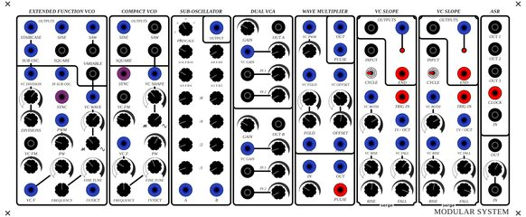</a> <b>HumanComparator Panel 4</b> <a href="Vector%20Graphics/HumanComparator_Panel_4.svg">SVG</a> · <a href="Drill%20Templates/HumanComparator_Panel_4.pdf">Drill</a></td>
<td align="center" valign="bottom"><a href="Images/Infinite_Melody.png">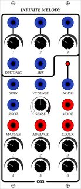</a> <b>Infinite Melody</b> <a href="Vector%20Graphics/Infinite_Melody.svg">SVG</a> · <a href="Drill%20Templates/Infinite_Melody.pdf">Drill</a></td>
</tr>
<tr>
<td align="center" valign="bottom"> <b>Logic</b> <a href="Vector%20Graphics/Logic.svg">SVG</a> · <a href="Drill%20Templates/Logic.pdf">Drill</a></td>
<td align="center" valign="bottom"><a href="Images/Master_Divider.png">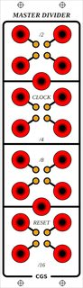</a> <b>Master Divider</b> <a href="Vector%20Graphics/Master_Divider.svg">SVG</a> · <a href="Drill%20Templates/Master_Divider.pdf">Drill</a></td>
<td align="center" valign="bottom"><a href="Images/Master_Divider_Catgirl.png">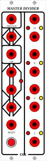</a> <b>Master Divider Catgirl</b> <a href="Vector%20Graphics/Master_Divider_Catgirl.svg">SVG</a> · <a href="Drill%20Templates/Master_Divider_Catgirl.pdf">Drill</a></td>
<td align="center" valign="bottom"><a href="Images/Master_LFO.png">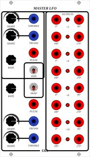</a> <b>Master LFO</b> <a href="Vector%20Graphics/Master_LFO.svg">SVG</a> · <a href="Drill%20Templates/Master_LFO.pdf">Drill</a></td>
<td align="center" valign="bottom"><a href="Images/Mixer_HumanComparator.png">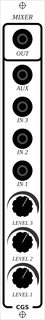</a> <b>Mixer HumanComparator</b> <a href="Vector%20Graphics/Mixer_HumanComparator.svg">SVG</a> · <a href="Drill%20Templates/Mixer_HumanComparator.pdf">Drill</a></td>
</tr>
<tr>
<td align="center" valign="bottom"><a href="Images/Mixers.png">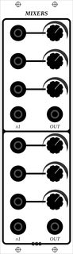</a> <b>Mixers</b> <a href="Vector%20Graphics/Mixers.svg">SVG</a> · <a href="Drill%20Templates/Mixers.pdf">Drill</a> · <a href="https://computerstaat.github.io/Serge-Synthesizer-Panel-art-and-design-files/Modules/vc-phaser.html">Build</a></td>
<td align="center" valign="bottom"><a href="Images/Modulo_Magic.png">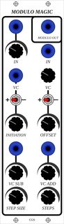</a> <b>Modulo Magic</b> <a href="Vector%20Graphics/Modulo_Magic.svg">SVG</a> · <a href="Drill%20Templates/Modulo_Magic.pdf">Drill</a></td>
<td align="center" valign="bottom"><a href="Images/New_Compact_Oscillator.png">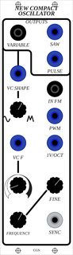</a> <b>New Compact Oscillator</b> <a href="Vector%20Graphics/New_Compact_Oscillator.svg">SVG</a> · <a href="Drill%20Templates/New_Compact_Oscillator.pdf">Drill</a></td>
<td align="center" valign="bottom"><a href="Images/Outputs.png">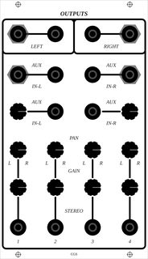</a> <b>Outputs</b> <a href="Vector%20Graphics/Outputs.svg">SVG</a> · <a href="Drill%20Templates/Outputs.pdf">Drill</a></td>
<td align="center" valign="bottom"><a href="Images/Outputs_Paperface.png">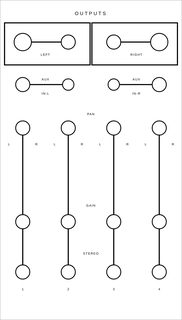</a> <b>Outputs Paperface</b> <a href="Vector%20Graphics/Outputs_Paperface.svg">SVG</a> · <a href="Drill%20Templates/Outputs_Paperface.pdf">Drill</a></td>
</tr>
<tr>
<td align="center" valign="bottom"><a href="Images/Peaks_and_Troughs.png">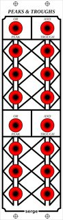</a> <b>Peaks and Troughs</b> <a href="Vector%20Graphics/Peaks_and_Troughs.svg">SVG</a> · <a href="Drill%20Templates/Peaks_and_Troughs.pdf">Drill</a></td>
<td align="center" valign="bottom"><a href="Images/Phaser_CGS90.png">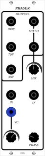</a> <b>Phaser CGS90</b> <a href="Vector%20Graphics/Phaser_CGS90.svg">SVG</a> · <a href="Drill%20Templates/Phaser_CGS90.pdf">Drill</a> · <a href="https://computerstaat.github.io/Serge-Synthesizer-Panel-art-and-design-files/Modules/vc-phaser.html">Build</a></td>
<td align="center" valign="bottom"><a href="Images/Phaser_with_Mixers.png">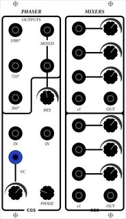</a> <b>Phaser with Mixers</b> <a href="Vector%20Graphics/Phaser_with_Mixers.svg">SVG</a> · <a href="Drill%20Templates/Phaser_with_Mixers.pdf">Drill</a> · <a href="https://computerstaat.github.io/Serge-Synthesizer-Panel-art-and-design-files/Modules/vc-phaser.html">Build</a></td>
<td align="center" valign="bottom"><a href="Images/Precision_VCO_Catgirl.png">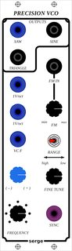</a> <b>Precision VCO Catgirl</b> <a href="Vector%20Graphics/Precision_VCO_Catgirl.svg">SVG</a> · <a href="Drill%20Templates/Precision_VCO_Catgirl.pdf">Drill</a></td>
<td align="center" valign="bottom"><a href="Images/Reverb_Paperface.png">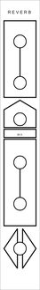</a> <b>Reverb Paperface</b> <a href="Vector%20Graphics/Reverb_Paperface.svg">SVG</a> · <a href="Drill%20Templates/Reverb_Paperface.pdf">Drill</a></td>
</tr>
<tr>
<td align="center" valign="bottom"><a href="Images/Send_and_Receive_Paperface.png">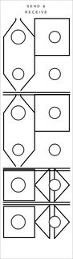</a> <b>Send and Receive Paperface</b> <a href="Vector%20Graphics/Send_and_Receive_Paperface.svg">SVG</a> · <a href="Drill%20Templates/Send_and_Receive_Paperface.pdf">Drill</a></td>
<td align="center" valign="bottom"><a href="Images/Sequencers_10_Stage_Triple.png">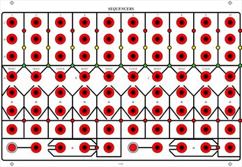</a> <b>Sequencers 10 Stage Triple</b> <a href="Vector%20Graphics/Sequencers_10_Stage_Triple.svg">SVG</a> · <a href="Drill%20Templates/Sequencers_10_Stage_Triple.pdf">Drill</a></td>
<td align="center" valign="bottom"> <b>Sequential Switch</b> <a href="Vector%20Graphics/Sequential_Switch.svg">SVG</a> · <a href="Drill%20Templates/Sequential_Switch.pdf">Drill</a></td>
<td align="center" valign="bottom"> <b>Sequential Switch CV</b> <a href="Vector%20Graphics/Sequential_Switch_CV.svg">SVG</a> · <a href="Drill%20Templates/Sequential_Switch_CV.pdf">Drill</a></td>
<td align="center" valign="bottom"> <b>Slope Detector</b> <a href="Vector%20Graphics/Slope_Detector.svg">SVG</a> · <a href="Drill%20Templates/Slope_Detector.pdf">Drill</a></td>
</tr>
<tr>
<td align="center" valign="bottom"> <b>Smooth Stepped Function Catgirl</b> <a href="Vector%20Graphics/Smooth_Stepped_Function_Catgirl.svg">SVG</a> · <a href="Drill%20Templates/Smooth_Stepped_Function_Catgirl.pdf">Drill</a></td>
<td align="center" valign="bottom"> <b>Sub Oscillator</b> <a href="Vector%20Graphics/Sub_Oscillator.svg">SVG</a> · <a href="Drill%20Templates/Sub_Oscillator.pdf">Drill</a></td>
<td align="center" valign="bottom"> <b>Sub Oscillator HumanComparator</b> <a href="Vector%20Graphics/Sub_Oscillator_HumanComparator.svg">SVG</a> · <a href="Drill%20Templates/Sub_Oscillator_HumanComparator.pdf">Drill</a></td>
<td align="center" valign="bottom"> <b>Touch Activated Programmer Sequencer</b> <a href="Vector%20Graphics/Touch_Activated_Programmer_Sequencer.svg">SVG</a> · <a href="Drill%20Templates/Touch_Activated_Programmer_Sequencer.pdf">Drill</a></td>
<td align="center" valign="bottom"> <b>Utility LFO</b> <a href="Vector%20Graphics/Utility_LFO.svg">SVG</a> · <a href="Drill%20Templates/Utility_LFO.pdf">Drill</a></td>
</tr>
<tr>
<td align="center" valign="bottom"> <b>VC Divider</b> <a href="Vector%20Graphics/VC_Divider.svg">SVG</a> · <a href="Drill%20Templates/VC_Divider.pdf">Drill</a></td>
<td align="center" valign="bottom"> <b>VC Filter HumanComparator</b> <a href="Vector%20Graphics/VC_Filter_HumanComparator.svg">SVG</a> · <a href="Drill%20Templates/VC_Filter_HumanComparator.pdf">Drill</a></td>
<td align="center" valign="bottom"> <b>VC Slope</b> <a href="Vector%20Graphics/VC_Slope.svg">SVG</a> · <a href="Drill%20Templates/VC_Slope.pdf">Drill</a></td>
<td align="center" valign="bottom"> <b>VC Stereo Mixer Catgirl</b> <a href="Vector%20Graphics/VC_Stereo_Mixer_Catgirl.svg">SVG</a> · <a href="Drill%20Templates/VC_Stereo_Mixer_Catgirl.pdf">Drill</a></td>
<td align="center" valign="bottom"> <b>Variable Q VCF Catgirl</b> <a href="Vector%20Graphics/Variable_Q_VCF_Catgirl.svg">SVG</a> · <a href="Drill%20Templates/Variable_Q_VCF_Catgirl.pdf">Drill</a></td>
</tr>
<tr>
<td align="center" valign="bottom"> <b>Wave Multiplier</b> <a href="Vector%20Graphics/Wave_Multiplier.svg">SVG</a> · <a href="Drill%20Templates/Wave_Multiplier.pdf">Drill</a></td>
<td align="center" valign="bottom"> <b>Wave Multiplier 2in</b> <a href="Vector%20Graphics/Wave_Multiplier_2in.svg">SVG</a> · <a href="Drill%20Templates/Wave_Multiplier_2in.pdf">Drill</a></td>
<td align="center" valign="bottom"> <b>Wave Multipliers Catgirl</b> <a href="Vector%20Graphics/Wave_Multipliers_Catgirl.svg">SVG</a> · <a href="Drill%20Templates/Wave_Multipliers_Catgirl.pdf">Drill</a></td>
<td align="center" valign="bottom"> <b>Wave Multipliers HumanComparator</b> <a href="Vector%20Graphics/Wave_Multipliers_HumanComparator.svg">SVG</a> · <a href="Drill%20Templates/Wave_Multipliers_HumanComparator.pdf">Drill</a></td>
</tr>
</table>

<!-- gallery:end -->

| File | Module |
|---|---|
| Extended_Function_VCO | Extended Function VCO |
| Compact_VCO | Compact VCO |
| Dual_CMOS_Filter | Dual CMOS Filter |
| Digital_Noise | Digital Noise |
| Gated_Comparator | Gated Comparator |
| Infinite_Melody | Infinite Melody |
| CV_Cluster | CV Cluster |
| Slope_Detector | Slope Detector |
| VC_Divider | VC Divider |
| Utility_LFO | Utility LFO |
| Modulo_Magic | Modulo Magic |
| Master_Divider | Master Divider |
| Sub_Oscillator | Sub Oscillator |
| Phaser_CGS90 | CGS90 Phaser (two IN jacks, from Ken Stone's panel) |
| Mixers | CGS90 Mixers: two 3-input mixers on the Phaser's PCB |
| Phaser_with_Mixers | 4" option: the CGS90 Phaser and its Mixers side by side |
| Drum_Sim, Chime_Sim, Cynare_Drum_Simulator | drum and chime simulators |
| CGS-Custom | a full 17" panel of CGS modules with the user's own CATGIRL SYNTH wordmark |

PNG in `Images`, SVG in `Vector Graphics`, 1:1 drill templates in `Drill Templates`; the Build Kit makes the
Front Panel Designer files into `Front Panel Express`.

## The Human Comparator panels

Four full panels from The Human Comparator (Stockholm) artwork, built from these modules. The Images, Vector Graphics and Drill Templates folders hold each panel and each module.

| Panel | Modules |
|---|---|
| HumanComparator_Panel_1 | Extended ADSR ×2, Dual VCA, Modulo Magic, Wave Multiplier (1"), Infinite Melody, CV Cluster, Slope Detector ×2, Dual Processor |
| HumanComparator_Panel_2 | New Compact Oscillator ×2, Wave Multipliers, Mixer, VC Filter, Dual VCA, Dual Universal Slope Generator, VC Divider, Utility LFO |
| HumanComparator_Panel_3 | Digital Noise, Gated Comparator, Pulse Divider, Logic, 8 Stage Programmer Sequencer |
| HumanComparator_Panel_4 | Extended Function VCO, Compact VCO, Sub-Oscillator, Dual VCA (2"), Wave Multiplier (2"), VC Slope ×2, ASR |

Modules that differ from the versions already here carry `_HumanComparator` in the name: Extended ADSR, Dual Processor, Wave Multipliers, Mixer, VC Filter, DUSG, Digital Noise, Sub-Oscillator, Dual VCA and ASR. New modules: New_Compact_Oscillator, Wave_Multiplier (1"), Wave_Multiplier_2in, Logic, 8_Stage_Programmer_Sequencer and VC_Slope.

## Catgirl Synth panels

| Panel | Modules |
|---|---|
| Catgirl_Panel_DTG_Drums_LPG_Outputs | Dual Transient Generator ×2, Drum Sim, Chime Sim, Cynare Drum Simulator, Dual Lowpass Gate, Outputs |
| Catgirl_Panel_Switches_Logic_LFO | Sequential Switch (4" with CV) + 2× Sequential Switch, Pulse Divider ×2, Boolean Logic ×2, Master LFO |
| Catgirl_Panel_Sequencers_Logic_Dividers | Sequencers (10-stage triple, 10"), Peaks and Troughs, Divider and Logic, Master Divider (Catgirl version) |
| Catgirl_Panel_Touch_Programmer_Sequencer | Touch Activated Programmer Sequencer (16": 16 stages, knob rows A-D, touch plates) |
| Catgirl_Panel_VCOs_DUSG_Smooth_VCA_VCF_Stereo_Mixer | Precision VCO ×2, Dual Universal Slope Generator, Smooth / Stepped Function, Dual VCA, Variable Q VCF, VC Stereo Mixer (all `_Catgirl` versions) |
| Catgirl_Panel_VCOs_Wave_Multipliers_DTG_VCF_Audio_Mixer | Precision VCO ×2, Wave Multipliers, Smooth / Stepped Function, Dual Transient Generator, Variable Q VCF, Audio Mixer, Dual VCA, Adapters (`_Catgirl` versions) |
| Catgirl_Panel_Paperface_Oscillators_Comparator_Filter_KEG_Gate | paperface-style panel: Oscillator ×4, (Triple) Comparator, Filter, Keyboard Envelope Generator, Gate, built from the Paperface modules (16" wide, black line art like the Paperface set) |
| Catgirl_Panel_Paperface_Send_Receive_BPF_Phaser_Mixer_Ring_Reverb_Outputs | a DIY paperface-style panel (from a photo): Send & Receive, Band Pass Filters, Phaser, Audio Mixer, Ring, Reverb, Outputs (new `_Paperface` modules; Phaser and Ring are the Paperface ones) |

The two paperface-style panels are black line art like the Paperface set (no drawn jacks or knobs, 16" wide, no Front Panel Express files). The source artwork is in `Other/Reference Photos/CGS Panels` (not tracked).
