# Modern

The rounded-box Serge layouts: module name above the outline, boxed outputs, "serge" in the bottom edge. The same
layouts were used by the SMMS metal-overlay panels (about 1979 to the early 1990s) and by Sound Transform Systems
(STS, from 1992), which printed the graphics directly on the metal. Most drawings here follow the 1980 SMMS catalogue
and the STS catalogue; some follow photos of STS panels.

<!-- gallery:start (generated by tools/make_site.py) -->
## Panels

Click a picture for the full-size PNG. **SVG** is the artwork, **Drill** the 1:1 drill template, **Build** the module's build page. The same gallery is on the [website](https://computerstaat.github.io/Serge-Synthesizer-Panel-art-and-design-files/panels.html).

### Module (96)

<table>
<tr>
<td align="center" valign="bottom"><a href="Images/Module/4_Stage_Sequencing_Programmer.png">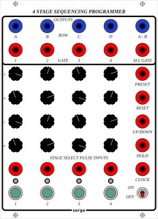</a> <b>4 Stage Sequencing Programmer</b> <a href="Vector%20Graphics/Module/4_Stage_Sequencing_Programmer.svg">SVG</a> · <a href="Drill%20Templates/Module/4_Stage_Sequencing_Programmer.pdf">Drill</a></td>
<td align="center" valign="bottom"><a href="Images/Module/5_Stage_Sequencing_Programmer.png">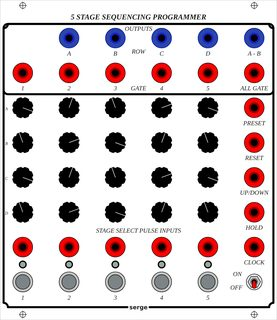</a> <b>5 Stage Sequencing Programmer</b> <a href="Vector%20Graphics/Module/5_Stage_Sequencing_Programmer.svg">SVG</a> · <a href="Drill%20Templates/Module/5_Stage_Sequencing_Programmer.pdf">Drill</a></td>
<td align="center" valign="bottom"><a href="Images/Module/6_Stage_Sequencing_Programmer.png">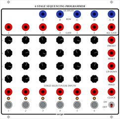</a> <b>6 Stage Sequencing Programmer</b> <a href="Vector%20Graphics/Module/6_Stage_Sequencing_Programmer.svg">SVG</a> · <a href="Drill%20Templates/Module/6_Stage_Sequencing_Programmer.pdf">Drill</a></td>
<td align="center" valign="bottom"><a href="Images/Module/7_Stage_Sequencing_Programmer.png">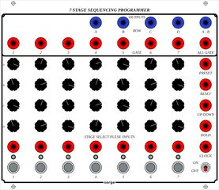</a> <b>7 Stage Sequencing Programmer</b> <a href="Vector%20Graphics/Module/7_Stage_Sequencing_Programmer.svg">SVG</a> · <a href="Drill%20Templates/Module/7_Stage_Sequencing_Programmer.pdf">Drill</a></td>
<td align="center" valign="bottom"><a href="Images/Module/8_Stage_Sequencing_Programmer.png">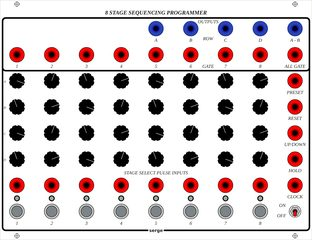</a> <b>8 Stage Sequencing Programmer</b> <a href="Vector%20Graphics/Module/8_Stage_Sequencing_Programmer.svg">SVG</a> · <a href="Drill%20Templates/Module/8_Stage_Sequencing_Programmer.pdf">Drill</a></td>
</tr>
<tr>
<td align="center" valign="bottom"><a href="Images/Module/ASR.png">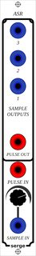</a> <b>ASR</b> <a href="Vector%20Graphics/Module/ASR.svg">SVG</a> · <a href="Drill%20Templates/Module/ASR.pdf">Drill</a></td>
<td align="center" valign="bottom"> <b>Active Process</b> <a href="Vector%20Graphics/Module/Active_Process.svg">SVG</a> · <a href="Drill%20Templates/Module/Active_Process.pdf">Drill</a></td>
<td align="center" valign="bottom"> <b>Active Processor</b> <a href="Vector%20Graphics/Module/Active_Processor.svg">SVG</a> · <a href="Drill%20Templates/Module/Active_Processor.pdf">Drill</a> · <a href="https://computerstaat.github.io/Serge-Synthesizer-Panel-art-and-design-files/Modules/active-processor.html">Build</a></td>
<td align="center" valign="bottom"><a href="Images/Module/Adapter.png">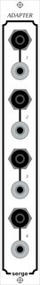</a> <b>Adapter</b> <a href="Vector%20Graphics/Module/Adapter.svg">SVG</a> · <a href="Drill%20Templates/Module/Adapter.pdf">Drill</a></td>
<td align="center" valign="bottom"><a href="Images/Module/Audio_Mixer.png">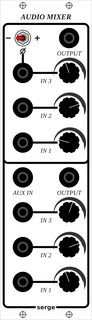</a> <b>Audio Mixer</b> <a href="Vector%20Graphics/Module/Audio_Mixer.svg">SVG</a> · <a href="Drill%20Templates/Module/Audio_Mixer.pdf">Drill</a> · <a href="https://computerstaat.github.io/Serge-Synthesizer-Panel-art-and-design-files/Modules/audio-mixer.html">Build</a></td>
</tr>
<tr>
<td align="center" valign="bottom"><a href="Images/Module/Boolean_Logic.png">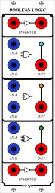</a> <b>Boolean Logic</b> <a href="Vector%20Graphics/Module/Boolean_Logic.svg">SVG</a> · <a href="Drill%20Templates/Module/Boolean_Logic.pdf">Drill</a></td>
<td align="center" valign="bottom"><a href="Images/Module/CV_Matrix_Mixer.png">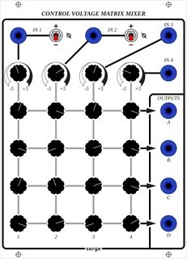</a> <b>CV Matrix Mixer</b> <a href="Vector%20Graphics/Module/CV_Matrix_Mixer.svg">SVG</a> · <a href="Drill%20Templates/Module/CV_Matrix_Mixer.pdf">Drill</a></td>
<td align="center" valign="bottom"><a href="Images/Module/CV_Mixer.png">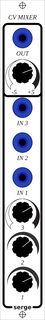</a> <b>CV Mixer</b> <a href="Vector%20Graphics/Module/CV_Mixer.svg">SVG</a> · <a href="Drill%20Templates/Module/CV_Mixer.pdf">Drill</a></td>
<td align="center" valign="bottom"> <b>CV Pro</b> <a href="Vector%20Graphics/Module/CV_Pro.svg">SVG</a> · <a href="Drill%20Templates/Module/CV_Pro.pdf">Drill</a></td>
<td align="center" valign="bottom"><a href="Images/Module/C_M.png">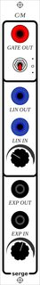</a> <b>C M</b> <a href="Vector%20Graphics/Module/C_M.svg">SVG</a> · <a href="Drill%20Templates/Module/C_M.pdf">Drill</a></td>
</tr>
<tr>
<td align="center" valign="bottom"><a href="Images/Module/C_M_numbered.png">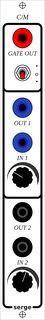</a> <b>C M numbered</b> <a href="Vector%20Graphics/Module/C_M_numbered.svg">SVG</a> · <a href="Drill%20Templates/Module/C_M_numbered.pdf">Drill</a></td>
<td align="center" valign="bottom"><a href="Images/Module/Divide_N_Comp.png">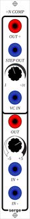</a> <b>Divide N Comp</b> <a href="Vector%20Graphics/Module/Divide_N_Comp.svg">SVG</a> · <a href="Drill%20Templates/Module/Divide_N_Comp.pdf">Drill</a> · <a href="https://computerstaat.github.io/Serge-Synthesizer-Panel-art-and-design-files/Modules/divide-n-comparator.html">Build</a></td>
<td align="center" valign="bottom"><a href="Images/Module/Dual_Analog_Shift_Register.png">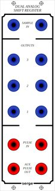</a> <b>Dual Analog Shift Register</b> <a href="Vector%20Graphics/Module/Dual_Analog_Shift_Register.svg">SVG</a> · <a href="Drill%20Templates/Module/Dual_Analog_Shift_Register.pdf">Drill</a> · <a href="https://computerstaat.github.io/Serge-Synthesizer-Panel-art-and-design-files/Modules/analog-shift-register.html">Build</a></td>
<td align="center" valign="bottom"><a href="Images/Module/Dual_Channel_Stereo_Mixer.png">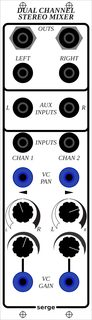</a> <b>Dual Channel Stereo Mixer</b> <a href="Vector%20Graphics/Module/Dual_Channel_Stereo_Mixer.svg">SVG</a> · <a href="Drill%20Templates/Module/Dual_Channel_Stereo_Mixer.pdf">Drill</a> · <a href="https://computerstaat.github.io/Serge-Synthesizer-Panel-art-and-design-files/Modules/dual-channel-stereo-mixer.html">Build</a></td>
<td align="center" valign="bottom"> <b>Dual Comp</b> <a href="Vector%20Graphics/Module/Dual_Comp.svg">SVG</a> · <a href="Drill%20Templates/Module/Dual_Comp.pdf">Drill</a> · <a href="https://computerstaat.github.io/Serge-Synthesizer-Panel-art-and-design-files/Modules/dual-comparator.html">Build</a></td>
</tr>
<tr>
<td align="center" valign="bottom"><a href="Images/Module/Dual_Envelope_Detector.png">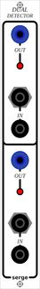</a> <b>Dual Envelope Detector</b> <a href="Vector%20Graphics/Module/Dual_Envelope_Detector.svg">SVG</a> · <a href="Drill%20Templates/Module/Dual_Envelope_Detector.pdf">Drill</a></td>
<td align="center" valign="bottom"><a href="Images/Module/Dual_Phaser.png">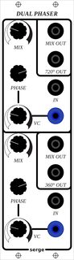</a> <b>Dual Phaser</b> <a href="Vector%20Graphics/Module/Dual_Phaser.svg">SVG</a> · <a href="Drill%20Templates/Module/Dual_Phaser.pdf">Drill</a></td>
<td align="center" valign="bottom"><a href="Images/Module/Dual_Processor.png">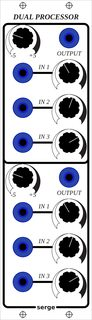</a> <b>Dual Processor</b> <a href="Vector%20Graphics/Module/Dual_Processor.svg">SVG</a> · <a href="Drill%20Templates/Module/Dual_Processor.pdf">Drill</a> · <a href="https://computerstaat.github.io/Serge-Synthesizer-Panel-art-and-design-files/Modules/dual-processor.html">Build</a></td>
<td align="center" valign="bottom"><a href="Images/Module/Dual_Random_Voltage_Generator.png">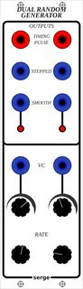</a> <b>Dual Random Voltage Generator</b> <a href="Vector%20Graphics/Module/Dual_Random_Voltage_Generator.svg">SVG</a> · <a href="Drill%20Templates/Module/Dual_Random_Voltage_Generator.pdf">Drill</a></td>
<td align="center" valign="bottom"><a href="Images/Module/Dual_Stereo_Panner.png">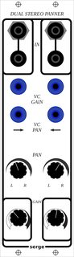</a> <b>Dual Stereo Panner</b> <a href="Vector%20Graphics/Module/Dual_Stereo_Panner.svg">SVG</a> · <a href="Drill%20Templates/Module/Dual_Stereo_Panner.pdf">Drill</a></td>
</tr>
<tr>
<td align="center" valign="bottom"> <b>Dual Transient Generator</b> <a href="Vector%20Graphics/Module/Dual_Transient_Generator.svg">SVG</a> · <a href="Drill%20Templates/Module/Dual_Transient_Generator.pdf">Drill</a> · <a href="https://computerstaat.github.io/Serge-Synthesizer-Panel-art-and-design-files/Modules/dual-transient-generator.html">Build</a></td>
<td align="center" valign="bottom"><a href="Images/Module/Dual_Transient_Generator_Bipolar.png">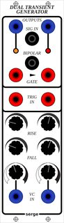</a> <b>Dual Transient Generator Bipolar</b> <a href="Vector%20Graphics/Module/Dual_Transient_Generator_Bipolar.svg">SVG</a> · <a href="Drill%20Templates/Module/Dual_Transient_Generator_Bipolar.pdf">Drill</a> · <a href="https://computerstaat.github.io/Serge-Synthesizer-Panel-art-and-design-files/Modules/dual-transient-generator.html">Build</a></td>
<td align="center" valign="bottom"><a href="Images/Module/Dual_Transient_Generator_Toggles.png">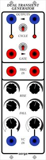</a> <b>Dual Transient Generator Toggles</b> <a href="Vector%20Graphics/Module/Dual_Transient_Generator_Toggles.svg">SVG</a> · <a href="Drill%20Templates/Module/Dual_Transient_Generator_Toggles.pdf">Drill</a> · <a href="https://computerstaat.github.io/Serge-Synthesizer-Panel-art-and-design-files/Modules/dual-transient-generator.html">Build</a></td>
<td align="center" valign="bottom"><a href="Images/Module/Dual_Universal_Slope_Generator.png">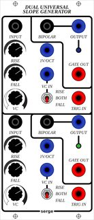</a> <b>Dual Universal Slope Generator</b> <a href="Vector%20Graphics/Module/Dual_Universal_Slope_Generator.svg">SVG</a> · <a href="Drill%20Templates/Module/Dual_Universal_Slope_Generator.pdf">Drill</a> · <a href="https://computerstaat.github.io/Serge-Synthesizer-Panel-art-and-design-files/Modules/dual-universal-slope-generator.html">Build</a></td>
<td align="center" valign="bottom"> <b>Dual VCA</b> <a href="Vector%20Graphics/Module/Dual_VCA.svg">SVG</a> · <a href="Drill%20Templates/Module/Dual_VCA.pdf">Drill</a> · <a href="https://computerstaat.github.io/Serge-Synthesizer-Panel-art-and-design-files/Modules/dual-vca.html">Build</a></td>
</tr>
<tr>
<td align="center" valign="bottom"><a href="Images/Module/Dual_VC_Clock.png">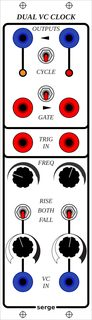</a> <b>Dual VC Clock</b> <a href="Vector%20Graphics/Module/Dual_VC_Clock.svg">SVG</a> · <a href="Drill%20Templates/Module/Dual_VC_Clock.pdf">Drill</a></td>
<td align="center" valign="bottom"> <b>Dual Waveshaper</b> <a href="Vector%20Graphics/Module/Dual_Waveshaper.svg">SVG</a> · <a href="Drill%20Templates/Module/Dual_Waveshaper.pdf">Drill</a></td>
<td align="center" valign="bottom"><a href="Images/Module/Envelope_Detector.png">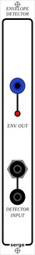</a> <b>Envelope Detector</b> <a href="Vector%20Graphics/Module/Envelope_Detector.svg">SVG</a> · <a href="Drill%20Templates/Module/Envelope_Detector.pdf">Drill</a></td>
<td align="center" valign="bottom"><a href="Images/Module/Extended_ADSR.png">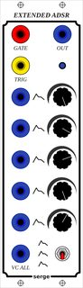</a> <b>Extended ADSR</b> <a href="Vector%20Graphics/Module/Extended_ADSR.svg">SVG</a> · <a href="Drill%20Templates/Module/Extended_ADSR.pdf">Drill</a> · <a href="https://computerstaat.github.io/Serge-Synthesizer-Panel-art-and-design-files/Modules/extended-adsr.html">Build</a></td>
<td align="center" valign="bottom"><a href="Images/Module/Extended_Range_VCF.png">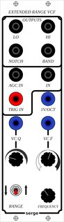</a> <b>Extended Range VCF</b> <a href="Vector%20Graphics/Module/Extended_Range_VCF.svg">SVG</a> · <a href="Drill%20Templates/Module/Extended_Range_VCF.pdf">Drill</a> · <a href="https://computerstaat.github.io/Serge-Synthesizer-Panel-art-and-design-files/Modules/extended-range-vcf.html">Build</a></td>
</tr>
<tr>
<td align="center" valign="bottom"><a href="Images/Module/Frequency_Shifter.png">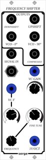</a> <b>Frequency Shifter</b> <a href="Vector%20Graphics/Module/Frequency_Shifter.svg">SVG</a> · <a href="Drill%20Templates/Module/Frequency_Shifter.pdf">Drill</a></td>
<td align="center" valign="bottom"><a href="Images/Module/Frequency_Shifter_External_Carrier.png">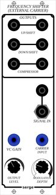</a> <b>Frequency Shifter External Carrier</b> <a href="Vector%20Graphics/Module/Frequency_Shifter_External_Carrier.svg">SVG</a> · <a href="Drill%20Templates/Module/Frequency_Shifter_External_Carrier.pdf">Drill</a></td>
<td align="center" valign="bottom"><a href="Images/Module/Gate_Sequencer.png">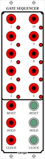</a> <b>Gate Sequencer</b> <a href="Vector%20Graphics/Module/Gate_Sequencer.svg">SVG</a> · <a href="Drill%20Templates/Module/Gate_Sequencer.pdf">Drill</a> · <a href="https://computerstaat.github.io/Serge-Synthesizer-Panel-art-and-design-files/Modules/gate-sequencer.html">Build</a></td>
<td align="center" valign="bottom"><a href="Images/Module/Matrix_Mixer.png">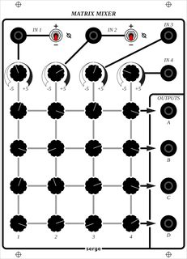</a> <b>Matrix Mixer</b> <a href="Vector%20Graphics/Module/Matrix_Mixer.svg">SVG</a> · <a href="Drill%20Templates/Module/Matrix_Mixer.pdf">Drill</a></td>
<td align="center" valign="bottom"> <b>Mix Pro</b> <a href="Vector%20Graphics/Module/Mix_Pro.svg">SVG</a> · <a href="Drill%20Templates/Module/Mix_Pro.pdf">Drill</a></td>
</tr>
<tr>
<td align="center" valign="bottom"> <b>Mixer</b> <a href="Vector%20Graphics/Module/Mixer.svg">SVG</a> · <a href="Drill%20Templates/Module/Mixer.pdf">Drill</a></td>
<td align="center" valign="bottom"><a href="Images/Module/Multi-Channel_Quadraphonic_Mixer.png">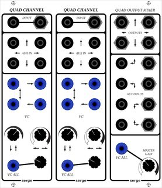</a> <b>Multi-Channel Quadraphonic Mixer</b> <a href="Vector%20Graphics/Module/Multi-Channel_Quadraphonic_Mixer.svg">SVG</a> · <a href="Drill%20Templates/Module/Multi-Channel_Quadraphonic_Mixer.pdf">Drill</a></td>
<td align="center" valign="bottom"><a href="Images/Module/New_Timbral_Oscillator.png">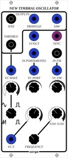</a> <b>New Timbral Oscillator</b> <a href="Vector%20Graphics/Module/New_Timbral_Oscillator.svg">SVG</a> · <a href="Drill%20Templates/Module/New_Timbral_Oscillator.pdf">Drill</a></td>
<td align="center" valign="bottom"><a href="Images/Module/New_Timbral_Oscillator_HiLo.png">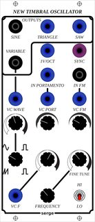</a> <b>New Timbral Oscillator HiLo</b> <a href="Vector%20Graphics/Module/New_Timbral_Oscillator_HiLo.svg">SVG</a> · <a href="Drill%20Templates/Module/New_Timbral_Oscillator_HiLo.pdf">Drill</a></td>
<td align="center" valign="bottom"><a href="Images/Module/Noise_Source.png">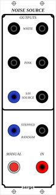</a> <b>Noise Source</b> <a href="Vector%20Graphics/Module/Noise_Source.svg">SVG</a> · <a href="Drill%20Templates/Module/Noise_Source.pdf">Drill</a> · <a href="https://computerstaat.github.io/Serge-Synthesizer-Panel-art-and-design-files/Modules/noise-source.html">Build</a></td>
</tr>
<tr>
<td align="center" valign="bottom"><a href="Images/Module/Pitch_and_Envelope_Follower.png">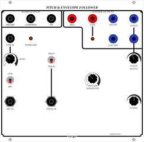</a> <b>Pitch and Envelope Follower</b> <a href="Vector%20Graphics/Module/Pitch_and_Envelope_Follower.svg">SVG</a> · <a href="Drill%20Templates/Module/Pitch_and_Envelope_Follower.pdf">Drill</a></td>
<td align="center" valign="bottom"> <b>Preamp Detector</b> <a href="Vector%20Graphics/Module/Preamp_Detector.svg">SVG</a> · <a href="Drill%20Templates/Module/Preamp_Detector.pdf">Drill</a></td>
<td align="center" valign="bottom"><a href="Images/Module/Preamp_Detector_DET.png">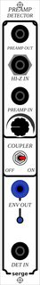</a> <b>Preamp Detector DET</b> <a href="Vector%20Graphics/Module/Preamp_Detector_DET.svg">SVG</a> · <a href="Drill%20Templates/Module/Preamp_Detector_DET.pdf">Drill</a></td>
<td align="center" valign="bottom"><a href="Images/Module/Preamp_Detector_Gate.png">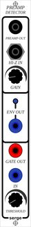</a> <b>Preamp Detector Gate</b> <a href="Vector%20Graphics/Module/Preamp_Detector_Gate.svg">SVG</a> · <a href="Drill%20Templates/Module/Preamp_Detector_Gate.pdf">Drill</a></td>
<td align="center" valign="bottom"><a href="Images/Module/Precision_VCO.png">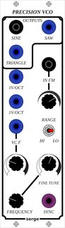</a> <b>Precision VCO</b> <a href="Vector%20Graphics/Module/Precision_VCO.svg">SVG</a> · <a href="Drill%20Templates/Module/Precision_VCO.pdf">Drill</a></td>
</tr>
<tr>
<td align="center" valign="bottom"><a href="Images/Module/Programmer_Sequencer.png">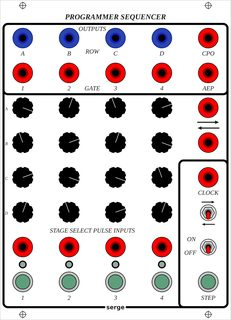</a> <b>Programmer Sequencer</b> <a href="Vector%20Graphics/Module/Programmer_Sequencer.svg">SVG</a> · <a href="Drill%20Templates/Module/Programmer_Sequencer.pdf">Drill</a> · <a href="https://computerstaat.github.io/Serge-Synthesizer-Panel-art-and-design-files/Modules/programmer-sequencer.html">Build</a></td>
<td align="center" valign="bottom"> <b>Pulse Divider</b> <a href="Vector%20Graphics/Module/Pulse_Divider.svg">SVG</a> · <a href="Drill%20Templates/Module/Pulse_Divider.pdf">Drill</a></td>
<td align="center" valign="bottom"><a href="Images/Module/Quad_Channel.png">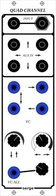</a> <b>Quad Channel</b> <a href="Vector%20Graphics/Module/Quad_Channel.svg">SVG</a> · <a href="Drill%20Templates/Module/Quad_Channel.pdf">Drill</a></td>
<td align="center" valign="bottom"><a href="Images/Module/Quad_Output_Mixer.png">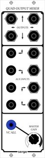</a> <b>Quad Output Mixer</b> <a href="Vector%20Graphics/Module/Quad_Output_Mixer.svg">SVG</a> · <a href="Drill%20Templates/Module/Quad_Output_Mixer.pdf">Drill</a></td>
<td align="center" valign="bottom"><a href="Images/Module/Quad_VCA.png">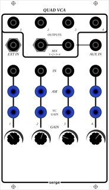</a> <b>Quad VCA</b> <a href="Vector%20Graphics/Module/Quad_VCA.svg">SVG</a> · <a href="Drill%20Templates/Module/Quad_VCA.pdf">Drill</a></td>
</tr>
<tr>
<td align="center" valign="bottom"><a href="Images/Module/Quadrature_Oscillator.png">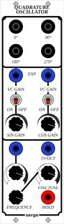</a> <b>Quadrature Oscillator</b> <a href="Vector%20Graphics/Module/Quadrature_Oscillator.svg">SVG</a> · <a href="Drill%20Templates/Module/Quadrature_Oscillator.pdf">Drill</a></td>
<td align="center" valign="bottom"><a href="Images/Module/Quantizer.png">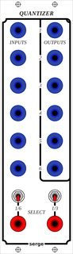</a> <b>Quantizer</b> <a href="Vector%20Graphics/Module/Quantizer.svg">SVG</a> · <a href="Drill%20Templates/Module/Quantizer.pdf">Drill</a></td>
<td align="center" valign="bottom"><a href="Images/Module/Quantizer_SQP.png">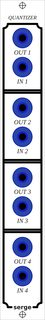</a> <b>Quantizer SQP</b> <a href="Vector%20Graphics/Module/Quantizer_SQP.svg">SVG</a> · <a href="Drill%20Templates/Module/Quantizer_SQP.pdf">Drill</a></td>
<td align="center" valign="bottom"><a href="Images/Module/Quantizer_TKB.png">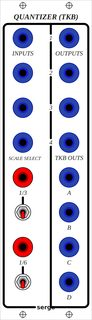</a> <b>Quantizer TKB</b> <a href="Vector%20Graphics/Module/Quantizer_TKB.svg">SVG</a> · <a href="Drill%20Templates/Module/Quantizer_TKB.pdf">Drill</a></td>
<td align="center" valign="bottom"><a href="Images/Module/Random_Source.png">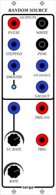</a> <b>Random Source</b> <a href="Vector%20Graphics/Module/Random_Source.svg">SVG</a> · <a href="Drill%20Templates/Module/Random_Source.pdf">Drill</a></td>
</tr>
<tr>
<td align="center" valign="bottom"><a href="Images/Module/Random_Source_Trig_Button.png">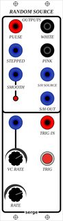</a> <b>Random Source Trig Button</b> <a href="Vector%20Graphics/Module/Random_Source_Trig_Button.svg">SVG</a> · <a href="Drill%20Templates/Module/Random_Source_Trig_Button.pdf">Drill</a></td>
<td align="center" valign="bottom"> <b>Random Voltage Generator</b> <a href="Vector%20Graphics/Module/Random_Voltage_Generator.svg">SVG</a> · <a href="Drill%20Templates/Module/Random_Voltage_Generator.pdf">Drill</a></td>
<td align="center" valign="bottom"> <b>Resonant Equalizer</b> <a href="Vector%20Graphics/Module/Resonant_Equalizer.svg">SVG</a> · <a href="Drill%20Templates/Module/Resonant_Equalizer.pdf">Drill</a> · <a href="https://computerstaat.github.io/Serge-Synthesizer-Panel-art-and-design-files/Modules/resonant-equalizer.html">Build</a></td>
<td align="center" valign="bottom"> <b>Ring Modulator</b> <a href="Vector%20Graphics/Module/Ring_Modulator.svg">SVG</a> · <a href="Drill%20Templates/Module/Ring_Modulator.pdf">Drill</a> · <a href="https://computerstaat.github.io/Serge-Synthesizer-Panel-art-and-design-files/Modules/ring-modulator.html">Build</a></td>
<td align="center" valign="bottom"> <b>Scaling Buffers</b> <a href="Vector%20Graphics/Module/Scaling_Buffers.svg">SVG</a> · <a href="Drill%20Templates/Module/Scaling_Buffers.pdf">Drill</a></td>
</tr>
<tr>
<td align="center" valign="bottom"> <b>Scaling Processor</b> <a href="Vector%20Graphics/Module/Scaling_Processor.svg">SVG</a> · <a href="Drill%20Templates/Module/Scaling_Processor.pdf">Drill</a> · <a href="https://computerstaat.github.io/Serge-Synthesizer-Panel-art-and-design-files/Modules/scaling-processor.html">Build</a></td>
<td align="center" valign="bottom"> <b>Schmitt Triggers</b> <a href="Vector%20Graphics/Module/Schmitt_Triggers.svg">SVG</a> · <a href="Drill%20Templates/Module/Schmitt_Triggers.pdf">Drill</a></td>
<td align="center" valign="bottom"> <b>Sequencer</b> <a href="Vector%20Graphics/Module/Sequencer.svg">SVG</a> · <a href="Drill%20Templates/Module/Sequencer.pdf">Drill</a> · <a href="https://computerstaat.github.io/Serge-Synthesizer-Panel-art-and-design-files/Modules/sequencer-10-stage.html">Build</a></td>
<td align="center" valign="bottom"> <b>Sequencer Buttons</b> <a href="Vector%20Graphics/Module/Sequencer_Buttons.svg">SVG</a> · <a href="Drill%20Templates/Module/Sequencer_Buttons.pdf">Drill</a></td>
<td align="center" valign="bottom"> <b>Smooth Stepped Function Generators</b> <a href="Vector%20Graphics/Module/Smooth_Stepped_Function_Generators.svg">SVG</a> · <a href="Drill%20Templates/Module/Smooth_Stepped_Function_Generators.pdf">Drill</a></td>
</tr>
<tr>
<td align="center" valign="bottom"> <b>Smooth Stepped Generator</b> <a href="Vector%20Graphics/Module/Smooth_Stepped_Generator.svg">SVG</a> · <a href="Drill%20Templates/Module/Smooth_Stepped_Generator.pdf">Drill</a> · <a href="https://computerstaat.github.io/Serge-Synthesizer-Panel-art-and-design-files/Modules/smooth-stepped-generator.html">Build</a></td>
<td align="center" valign="bottom"> <b>Stereo Output Mixer</b> <a href="Vector%20Graphics/Module/Stereo_Output_Mixer.svg">SVG</a> · <a href="Drill%20Templates/Module/Stereo_Output_Mixer.pdf">Drill</a></td>
<td align="center" valign="bottom"> <b>Tri-Core VCO</b> <a href="Vector%20Graphics/Module/Tri-Core_VCO.svg">SVG</a> · <a href="Drill%20Templates/Module/Tri-Core_VCO.pdf">Drill</a> · <a href="https://computerstaat.github.io/Serge-Synthesizer-Panel-art-and-design-files/Modules/tri-core-vco.html">Build</a></td>
<td align="center" valign="bottom"> <b>Triple Bi-Directional Router</b> <a href="Vector%20Graphics/Module/Triple_Bi-Directional_Router.svg">SVG</a> · <a href="Drill%20Templates/Module/Triple_Bi-Directional_Router.pdf">Drill</a> · <a href="https://computerstaat.github.io/Serge-Synthesizer-Panel-art-and-design-files/Modules/bi-directional-router.html">Build</a></td>
<td align="center" valign="bottom"> <b>Triple Bi-Directional Router Inverters</b> <a href="Vector%20Graphics/Module/Triple_Bi-Directional_Router_Inverters.svg">SVG</a> · <a href="Drill%20Templates/Module/Triple_Bi-Directional_Router_Inverters.pdf">Drill</a></td>
</tr>
<tr>
<td align="center" valign="bottom"> <b>Triple Comparator</b> <a href="Vector%20Graphics/Module/Triple_Comparator.svg">SVG</a> · <a href="Drill%20Templates/Module/Triple_Comparator.pdf">Drill</a> · <a href="https://computerstaat.github.io/Serge-Synthesizer-Panel-art-and-design-files/Modules/triple-comparator.html">Build</a></td>
<td align="center" valign="bottom"> <b>Triple Waveshaper</b> <a href="Vector%20Graphics/Module/Triple_Waveshaper.svg">SVG</a> · <a href="Drill%20Templates/Module/Triple_Waveshaper.pdf">Drill</a> · <a href="https://computerstaat.github.io/Serge-Synthesizer-Panel-art-and-design-files/Modules/triple-wave-shaper.html">Build</a></td>
<td align="center" valign="bottom"> <b>Triple Waveshaper Delta</b> <a href="Vector%20Graphics/Module/Triple_Waveshaper_Delta.svg">SVG</a> · <a href="Drill%20Templates/Module/Triple_Waveshaper_Delta.pdf">Drill</a></td>
<td align="center" valign="bottom"> <b>Universal Audio Processor</b> <a href="Vector%20Graphics/Module/Universal_Audio_Processor.svg">SVG</a> · <a href="Drill%20Templates/Module/Universal_Audio_Processor.pdf">Drill</a> · <a href="https://computerstaat.github.io/Serge-Synthesizer-Panel-art-and-design-files/Modules/universal-audio-processor.html">Build</a></td>
<td align="center" valign="bottom"> <b>Universal Equal Power Audio Processor</b> <a href="Vector%20Graphics/Module/Universal_Equal_Power_Audio_Processor.svg">SVG</a> · <a href="Drill%20Templates/Module/Universal_Equal_Power_Audio_Processor.pdf">Drill</a> · <a href="https://computerstaat.github.io/Serge-Synthesizer-Panel-art-and-design-files/Modules/universal-audio-processor.html">Build</a></td>
</tr>
<tr>
<td align="center" valign="bottom"> <b>VCA Comp</b> <a href="Vector%20Graphics/Module/VCA_Comp.svg">SVG</a> · <a href="Drill%20Templates/Module/VCA_Comp.pdf">Drill</a></td>
<td align="center" valign="bottom"> <b>VC Filter</b> <a href="Vector%20Graphics/Module/VC_Filter.svg">SVG</a> · <a href="Drill%20Templates/Module/VC_Filter.pdf">Drill</a></td>
<td align="center" valign="bottom"> <b>VC Phaser</b> <a href="Vector%20Graphics/Module/VC_Phaser.svg">SVG</a> · <a href="Drill%20Templates/Module/VC_Phaser.pdf">Drill</a> · <a href="https://computerstaat.github.io/Serge-Synthesizer-Panel-art-and-design-files/Modules/vc-phaser.html">Build</a></td>
<td align="center" valign="bottom"> <b>VC Stereo Mixer</b> <a href="Vector%20Graphics/Module/VC_Stereo_Mixer.svg">SVG</a> · <a href="Drill%20Templates/Module/VC_Stereo_Mixer.pdf">Drill</a></td>
<td align="center" valign="bottom"> <b>VC Timegen Clock</b> <a href="Vector%20Graphics/Module/VC_Timegen_Clock.svg">SVG</a> · <a href="Drill%20Templates/Module/VC_Timegen_Clock.pdf">Drill</a></td>
</tr>
<tr>
<td align="center" valign="bottom"> <b>VC Timegen Osc</b> <a href="Vector%20Graphics/Module/VC_Timegen_Osc.svg">SVG</a> · <a href="Drill%20Templates/Module/VC_Timegen_Osc.pdf">Drill</a></td>
<td align="center" valign="bottom"> <b>Variable Bandwidth VCF</b> <a href="Vector%20Graphics/Module/Variable_Bandwidth_VCF.svg">SVG</a> · <a href="Drill%20Templates/Module/Variable_Bandwidth_VCF.pdf">Drill</a></td>
<td align="center" valign="bottom"> <b>Variable Bandwidth VCF LE</b> <a href="Vector%20Graphics/Module/Variable_Bandwidth_VCF_LE.svg">SVG</a> · <a href="Drill%20Templates/Module/Variable_Bandwidth_VCF_LE.pdf">Drill</a></td>
<td align="center" valign="bottom"> <b>Variable Q VCF</b> <a href="Vector%20Graphics/Module/Variable_Q_VCF.svg">SVG</a> · <a href="Drill%20Templates/Module/Variable_Q_VCF.pdf">Drill</a> · <a href="https://computerstaat.github.io/Serge-Synthesizer-Panel-art-and-design-files/Modules/extended-range-vcf.html">Build</a></td>
<td align="center" valign="bottom"> <b>Variable Q VCF LE</b> <a href="Vector%20Graphics/Module/Variable_Q_VCF_LE.svg">SVG</a> · <a href="Drill%20Templates/Module/Variable_Q_VCF_LE.pdf">Drill</a></td>
</tr>
<tr>
<td align="center" valign="bottom"> <b>Variable Slope VCF</b> <a href="Vector%20Graphics/Module/Variable_Slope_VCF.svg">SVG</a> · <a href="Drill%20Templates/Module/Variable_Slope_VCF.pdf">Drill</a> · <a href="https://computerstaat.github.io/Serge-Synthesizer-Panel-art-and-design-files/Modules/variable-slope-vcf.html">Build</a></td>
<td align="center" valign="bottom"> <b>Variable Slope VCF LE</b> <a href="Vector%20Graphics/Module/Variable_Slope_VCF_LE.svg">SVG</a> · <a href="Drill%20Templates/Module/Variable_Slope_VCF_LE.pdf">Drill</a> · <a href="https://computerstaat.github.io/Serge-Synthesizer-Panel-art-and-design-files/Modules/variable-slope-vcf.html">Build</a></td>
<td align="center" valign="bottom"> <b>Wave Multipliers</b> <a href="Vector%20Graphics/Module/Wave_Multipliers.svg">SVG</a> · <a href="Drill%20Templates/Module/Wave_Multipliers.pdf">Drill</a> · <a href="https://computerstaat.github.io/Serge-Synthesizer-Panel-art-and-design-files/Modules/wave-multipliers.html">Build</a></td>
<td align="center" valign="bottom"> <b>Wilson Analog Delay</b> <a href="Vector%20Graphics/Module/Wilson_Analog_Delay.svg">SVG</a> · <a href="Drill%20Templates/Module/Wilson_Analog_Delay.pdf">Drill</a></td>
<td align="center" valign="bottom"> <b>X Fader</b> <a href="Vector%20Graphics/Module/X_Fader.svg">SVG</a> · <a href="Drill%20Templates/Module/X_Fader.pdf">Drill</a> · <a href="https://computerstaat.github.io/Serge-Synthesizer-Panel-art-and-design-files/Modules/x-fader.html">Build</a></td>
</tr>
<tr>
<td align="center" valign="bottom"> <b>X Fader 2</b> <a href="Vector%20Graphics/Module/X_Fader_2.svg">SVG</a> · <a href="Drill%20Templates/Module/X_Fader_2.pdf">Drill</a> · <a href="https://computerstaat.github.io/Serge-Synthesizer-Panel-art-and-design-files/Modules/x-fader.html">Build</a></td>
</tr>
</table>

### Full Panel (26)

<table>
<tr>
<td align="center" valign="bottom"> <b>Animal</b> <a href="Vector%20Graphics/Full%20Panel/Animal.svg">SVG</a> · <a href="Drill%20Templates/Full%20Panel/Animal.pdf">Drill</a></td>
<td align="center" valign="bottom"> <b>Animate</b> <a href="Vector%20Graphics/Full%20Panel/Animate.svg">SVG</a> · <a href="Drill%20Templates/Full%20Panel/Animate.pdf">Drill</a></td>
<td align="center" valign="bottom"> <b>Animoo-CGS</b> <a href="Vector%20Graphics/Full%20Panel/Animoo-CGS.svg">SVG</a> · <a href="Drill%20Templates/Full%20Panel/Animoo-CGS.pdf">Drill</a></td>
</tr>
<tr>
<td align="center" valign="bottom"> <b>Animoo Tri-Core</b> <a href="Vector%20Graphics/Full%20Panel/Animoo_Tri-Core.svg">SVG</a> · <a href="Drill%20Templates/Full%20Panel/Animoo_Tri-Core.pdf">Drill</a> · <a href="https://computerstaat.github.io/Serge-Synthesizer-Panel-art-and-design-files/Modules/tri-core-vco.html">Build</a></td>
<td align="center" valign="bottom"> <b>Blue Control</b> <a href="Vector%20Graphics/Full%20Panel/Blue_Control.svg">SVG</a> · <a href="Drill%20Templates/Full%20Panel/Blue_Control.pdf">Drill</a></td>
<td align="center" valign="bottom"> <b>Blue Voice</b> <a href="Vector%20Graphics/Full%20Panel/Blue_Voice.svg">SVG</a> · <a href="Drill%20Templates/Full%20Panel/Blue_Voice.pdf">Drill</a></td>
</tr>
<tr>
<td align="center" valign="bottom"> <b>CalArts Panel 1</b> <a href="Vector%20Graphics/Full%20Panel/CalArts_Panel_1.svg">SVG</a> · <a href="Drill%20Templates/Full%20Panel/CalArts_Panel_1.pdf">Drill</a></td>
<td align="center" valign="bottom"> <b>CalArts Panel 1 Black</b> <a href="Vector%20Graphics/Full%20Panel/CalArts_Panel_1_Black.svg">SVG</a></td>
<td align="center" valign="bottom"> <b>CalArts Panel 2</b> <a href="Vector%20Graphics/Full%20Panel/CalArts_Panel_2.svg">SVG</a> · <a href="Drill%20Templates/Full%20Panel/CalArts_Panel_2.pdf">Drill</a></td>
</tr>
<tr>
<td align="center" valign="bottom"> <b>CalArts Panel 2 Black</b> <a href="Vector%20Graphics/Full%20Panel/CalArts_Panel_2_Black.svg">SVG</a></td>
<td align="center" valign="bottom"> <b>CalArts Panel 3</b> <a href="Vector%20Graphics/Full%20Panel/CalArts_Panel_3.svg">SVG</a> · <a href="Drill%20Templates/Full%20Panel/CalArts_Panel_3.pdf">Drill</a></td>
<td align="center" valign="bottom"> <b>CalArts Panel 3 Black</b> <a href="Vector%20Graphics/Full%20Panel/CalArts_Panel_3_Black.svg">SVG</a></td>
</tr>
<tr>
<td align="center" valign="bottom"> <b>CalArts Panel 4</b> <a href="Vector%20Graphics/Full%20Panel/CalArts_Panel_4.svg">SVG</a> · <a href="Drill%20Templates/Full%20Panel/CalArts_Panel_4.pdf">Drill</a></td>
<td align="center" valign="bottom"> <b>CalArts Panel 4 Black</b> <a href="Vector%20Graphics/Full%20Panel/CalArts_Panel_4_Black.svg">SVG</a></td>
<td align="center" valign="bottom"> <b>CalArts Sloped Panel</b> <a href="Vector%20Graphics/Full%20Panel/CalArts_Sloped_Panel.svg">SVG</a> · <a href="Drill%20Templates/Full%20Panel/CalArts_Sloped_Panel.pdf">Drill</a></td>
</tr>
<tr>
<td align="center" valign="bottom"> <b>CalArts Sloped Panel Black</b> <a href="Vector%20Graphics/Full%20Panel/CalArts_Sloped_Panel_Black.svg">SVG</a></td>
<td align="center" valign="bottom"> <b>Moby Series79 Panel 1</b> <a href="Vector%20Graphics/Full%20Panel/Moby_Series79_Panel_1.svg">SVG</a> · <a href="Drill%20Templates/Full%20Panel/Moby_Series79_Panel_1.pdf">Drill</a></td>
<td align="center" valign="bottom"> <b>Moby Series79 Panel 2</b> <a href="Vector%20Graphics/Full%20Panel/Moby_Series79_Panel_2.svg">SVG</a> · <a href="Drill%20Templates/Full%20Panel/Moby_Series79_Panel_2.pdf">Drill</a></td>
</tr>
<tr>
<td align="center" valign="bottom"> <b>Programmer Panel v2</b> <a href="Vector%20Graphics/Full%20Panel/Programmer_Panel_v2.svg">SVG</a> · <a href="Drill%20Templates/Full%20Panel/Programmer_Panel_v2.pdf">Drill</a></td>
<td align="center" valign="bottom"> <b>Red Control</b> <a href="Vector%20Graphics/Full%20Panel/Red_Control.svg">SVG</a> · <a href="Drill%20Templates/Full%20Panel/Red_Control.pdf">Drill</a></td>
<td align="center" valign="bottom"> <b>Red Voice</b> <a href="Vector%20Graphics/Full%20Panel/Red_Voice.svg">SVG</a> · <a href="Drill%20Templates/Full%20Panel/Red_Voice.pdf">Drill</a></td>
</tr>
<tr>
<td align="center" valign="bottom"> <b>Sequencer</b> <a href="Vector%20Graphics/Full%20Panel/Sequencer.svg">SVG</a> · <a href="Drill%20Templates/Full%20Panel/Sequencer.pdf">Drill</a></td>
<td align="center" valign="bottom"> <b>Soup Kitchen 1</b> <a href="Vector%20Graphics/Full%20Panel/Soup_Kitchen_1.svg">SVG</a> · <a href="Drill%20Templates/Full%20Panel/Soup_Kitchen_1.pdf">Drill</a></td>
<td align="center" valign="bottom"> <b>Soup Kitchen 2</b> <a href="Vector%20Graphics/Full%20Panel/Soup_Kitchen_2.svg">SVG</a> · <a href="Drill%20Templates/Full%20Panel/Soup_Kitchen_2.pdf">Drill</a></td>
</tr>
<tr>
<td align="center" valign="bottom"> <b>Touch Activated Keyboard Sequencer</b> <a href="Vector%20Graphics/Full%20Panel/Touch_Activated_Keyboard_Sequencer.svg">SVG</a> · <a href="Drill%20Templates/Full%20Panel/Touch_Activated_Keyboard_Sequencer.pdf">Drill</a></td>
<td align="center" valign="bottom"> <b>Touch Activated Keyboard Sequencer Black</b> <a href="Vector%20Graphics/Full%20Panel/Touch_Activated_Keyboard_Sequencer_Black.svg">SVG</a></td>
</tr>
</table>

### M-Class (28)

<table>
<tr>
<td align="center" valign="bottom"> <b>ASR Quan</b> <a href="Vector%20Graphics/M-Class/ASR_Quan.svg">SVG</a> · <a href="Drill%20Templates/M-Class/ASR_Quan.pdf">Drill</a></td>
<td align="center" valign="bottom"> <b>Audio Interface</b> <a href="Vector%20Graphics/M-Class/Audio_Interface.svg">SVG</a> · <a href="Drill%20Templates/M-Class/Audio_Interface.pdf">Drill</a></td>
<td align="center" valign="bottom"> <b>Bi-Filter</b> <a href="Vector%20Graphics/M-Class/Bi-Filter.svg">SVG</a> · <a href="Drill%20Templates/M-Class/Bi-Filter.pdf">Drill</a></td>
</tr>
<tr>
<td align="center" valign="bottom"> <b>CV Matrix Mixer</b> <a href="Vector%20Graphics/M-Class/CV_Matrix_Mixer.svg">SVG</a> · <a href="Drill%20Templates/M-Class/CV_Matrix_Mixer.pdf">Drill</a></td>
<td align="center" valign="bottom"> <b>CV Processor</b> <a href="Vector%20Graphics/M-Class/CV_Processor.svg">SVG</a> · <a href="Drill%20Templates/M-Class/CV_Processor.pdf">Drill</a></td>
<td align="center" valign="bottom"> <b>Creature</b> <a href="Vector%20Graphics/M-Class/Creature.svg">SVG</a> · <a href="Drill%20Templates/M-Class/Creature.pdf">Drill</a></td>
</tr>
<tr>
<td align="center" valign="bottom"> <b>Critter rebuilt</b> <a href="Vector%20Graphics/M-Class/Critter_rebuilt.svg">SVG</a> · <a href="Drill%20Templates/M-Class/Critter_rebuilt.pdf">Drill</a></td>
<td align="center" valign="bottom"> <b>Dual ADSR</b> <a href="Vector%20Graphics/M-Class/Dual_ADSR.svg">SVG</a> · <a href="Drill%20Templates/M-Class/Dual_ADSR.pdf">Drill</a></td>
<td align="center" valign="bottom"> <b>Dual NTO</b> <a href="Vector%20Graphics/M-Class/Dual_NTO.svg">SVG</a> · <a href="Drill%20Templates/M-Class/Dual_NTO.pdf">Drill</a></td>
</tr>
<tr>
<td align="center" valign="bottom"> <b>Dual Oscillator</b> <a href="Vector%20Graphics/M-Class/Dual_Oscillator.svg">SVG</a> · <a href="Drill%20Templates/M-Class/Dual_Oscillator.pdf">Drill</a></td>
<td align="center" valign="bottom"> <b>Dual Q Filters</b> <a href="Vector%20Graphics/M-Class/Dual_Q_Filters.svg">SVG</a> · <a href="Drill%20Templates/M-Class/Dual_Q_Filters.pdf">Drill</a></td>
<td align="center" valign="bottom"> <b>EQ Shift</b> <a href="Vector%20Graphics/M-Class/EQ_Shift.svg">SVG</a> · <a href="Drill%20Templates/M-Class/EQ_Shift.pdf">Drill</a></td>
</tr>
<tr>
<td align="center" valign="bottom"> <b>Gator</b> <a href="Vector%20Graphics/M-Class/Gator.svg">SVG</a> · <a href="Drill%20Templates/M-Class/Gator.pdf">Drill</a></td>
<td align="center" valign="bottom"> <b>Hex VCA Mixer</b> <a href="Vector%20Graphics/M-Class/Hex_VCA_Mixer.svg">SVG</a> · <a href="Drill%20Templates/M-Class/Hex_VCA_Mixer.pdf">Drill</a></td>
<td align="center" valign="bottom"> <b>Klangshifter</b> <a href="Vector%20Graphics/M-Class/Klangshifter.svg">SVG</a> · <a href="Drill%20Templates/M-Class/Klangshifter.pdf">Drill</a></td>
</tr>
<tr>
<td align="center" valign="bottom"> <b>Klangzeit</b> <a href="Vector%20Graphics/M-Class/Klangzeit.svg">SVG</a> · <a href="Drill%20Templates/M-Class/Klangzeit.pdf">Drill</a></td>
<td align="center" valign="bottom"> <b>Matrix Mixer</b> <a href="Vector%20Graphics/M-Class/Matrix_Mixer.svg">SVG</a> · <a href="Drill%20Templates/M-Class/Matrix_Mixer.pdf">Drill</a></td>
<td align="center" valign="bottom"> <b>Mayhem</b> <a href="Vector%20Graphics/M-Class/Mayhem.svg">SVG</a> · <a href="Drill%20Templates/M-Class/Mayhem.pdf">Drill</a></td>
</tr>
<tr>
<td align="center" valign="bottom"> <b>Multi Filter</b> <a href="Vector%20Graphics/M-Class/Multi_Filter.svg">SVG</a> · <a href="Drill%20Templates/M-Class/Multi_Filter.pdf">Drill</a></td>
<td align="center" valign="bottom"> <b>Multi Filter LE</b> <a href="Vector%20Graphics/M-Class/Multi_Filter_LE.svg">SVG</a> · <a href="Drill%20Templates/M-Class/Multi_Filter_LE.pdf">Drill</a></td>
<td align="center" valign="bottom"> <b>Quad Slope</b> <a href="Vector%20Graphics/M-Class/Quad_Slope.svg">SVG</a> · <a href="Drill%20Templates/M-Class/Quad_Slope.pdf">Drill</a></td>
</tr>
<tr>
<td align="center" valign="bottom"> <b>SQP Sequencer</b> <a href="Vector%20Graphics/M-Class/SQP_Sequencer.svg">SVG</a> · <a href="Drill%20Templates/M-Class/SQP_Sequencer.pdf">Drill</a></td>
<td align="center" valign="bottom"> <b>Sequencer A</b> <a href="Vector%20Graphics/M-Class/Sequencer_A.svg">SVG</a> · <a href="Drill%20Templates/M-Class/Sequencer_A.pdf">Drill</a></td>
<td align="center" valign="bottom"> <b>Stereo Mixer</b> <a href="Vector%20Graphics/M-Class/Stereo_Mixer.svg">SVG</a> · <a href="Drill%20Templates/M-Class/Stereo_Mixer.pdf">Drill</a></td>
</tr>
<tr>
<td align="center" valign="bottom"> <b>TripleFilter</b> <a href="Vector%20Graphics/M-Class/TripleFilter.svg">SVG</a> · <a href="Drill%20Templates/M-Class/TripleFilter.pdf">Drill</a></td>
<td align="center" valign="bottom"> <b>Triple Oscilator</b> <a href="Vector%20Graphics/M-Class/Triple_Oscilator.svg">SVG</a> · <a href="Drill%20Templates/M-Class/Triple_Oscilator.pdf">Drill</a></td>
<td align="center" valign="bottom"> <b>Wave Processor</b> <a href="Vector%20Graphics/M-Class/Wave_Processor.svg">SVG</a> · <a href="Drill%20Templates/M-Class/Wave_Processor.pdf">Drill</a></td>
</tr>
<tr>
<td align="center" valign="bottom"> <b>Wilson Analog Delay</b> <a href="Vector%20Graphics/M-Class/Wilson_Analog_Delay.svg">SVG</a> · <a href="Drill%20Templates/M-Class/Wilson_Analog_Delay.pdf">Drill</a></td>
</tr>
</table>

### Quarter Panel (8)

<table>
<tr>
<td align="center" valign="bottom"> <b>Dual Quad VCA</b> <a href="Vector%20Graphics/Quarter%20Panel/Dual_Quad_VCA.svg">SVG</a> · <a href="Drill%20Templates/Quarter%20Panel/Dual_Quad_VCA.pdf">Drill</a></td>
<td align="center" valign="bottom"> <b>Dual Wogglebug</b> <a href="Vector%20Graphics/Quarter%20Panel/Dual_Wogglebug.svg">SVG</a> · <a href="Drill%20Templates/Quarter%20Panel/Dual_Wogglebug.pdf">Drill</a></td>
<td align="center" valign="bottom"> <b>Noise Source Time Machine</b> <a href="Vector%20Graphics/Quarter%20Panel/Noise_Source_Time_Machine.svg">SVG</a> · <a href="Drill%20Templates/Quarter%20Panel/Noise_Source_Time_Machine.pdf">Drill</a></td>
</tr>
<tr>
<td align="center" valign="bottom"> <b>Preamp Resonant EQ Outsie</b> <a href="Vector%20Graphics/Quarter%20Panel/Preamp_Resonant_EQ_Outsie.svg">SVG</a> · <a href="Drill%20Templates/Quarter%20Panel/Preamp_Resonant_EQ_Outsie.pdf">Drill</a></td>
<td align="center" valign="bottom"> <b>Pulse Divider Boolean Logic NCOM</b> <a href="Vector%20Graphics/Quarter%20Panel/Pulse_Divider_Boolean_Logic_NCOM.svg">SVG</a> · <a href="Drill%20Templates/Quarter%20Panel/Pulse_Divider_Boolean_Logic_NCOM.pdf">Drill</a></td>
<td align="center" valign="bottom"> <b>SOSTF</b> <a href="Vector%20Graphics/Quarter%20Panel/SOSTF.svg">SVG</a> · <a href="Drill%20Templates/Quarter%20Panel/SOSTF.pdf">Drill</a></td>
</tr>
<tr>
<td align="center" valign="bottom"> <b>Triple Chorus Trapezoid Generator</b> <a href="Vector%20Graphics/Quarter%20Panel/Triple_Chorus_Trapezoid_Generator.svg">SVG</a> · <a href="Drill%20Templates/Quarter%20Panel/Triple_Chorus_Trapezoid_Generator.pdf">Drill</a></td>
<td align="center" valign="bottom"> <b>Variable Slope Filter Phaser</b> <a href="Vector%20Graphics/Quarter%20Panel/Variable_Slope_Filter_Phaser.svg">SVG</a> · <a href="Drill%20Templates/Quarter%20Panel/Variable_Slope_Filter_Phaser.pdf">Drill</a></td>
</tr>
</table>

### Full Panel/Custom (9)

<table>
<tr>
<td align="center" valign="bottom"> <b>Adapters Scaling Quadrature</b> <a href="Vector%20Graphics/Full%20Panel/Custom/Adapters_Scaling_Quadrature.svg">SVG</a> · <a href="Drill%20Templates/Full%20Panel/Custom/Adapters_Scaling_Quadrature.pdf">Drill</a></td>
<td align="center" valign="bottom"> <b>Cabinet Bottom Panel</b> <a href="Vector%20Graphics/Full%20Panel/Custom/Cabinet_Bottom_Panel.svg">SVG</a> · <a href="Drill%20Templates/Full%20Panel/Custom/Cabinet_Bottom_Panel.pdf">Drill</a></td>
<td align="center" valign="bottom"> <b>Cabinet Middle Panel</b> <a href="Vector%20Graphics/Full%20Panel/Custom/Cabinet_Middle_Panel.svg">SVG</a> · <a href="Drill%20Templates/Full%20Panel/Custom/Cabinet_Middle_Panel.pdf">Drill</a></td>
</tr>
<tr>
<td align="center" valign="bottom"> <b>DUSG Quad VCA UPAP</b> <a href="Vector%20Graphics/Full%20Panel/Custom/DUSG_Quad_VCA_UPAP.svg">SVG</a> · <a href="Drill%20Templates/Full%20Panel/Custom/DUSG_Quad_VCA_UPAP.pdf">Drill</a></td>
<td align="center" valign="bottom"> <b>Preamp Precision Stereo Mixer</b> <a href="Vector%20Graphics/Full%20Panel/Custom/Preamp_Precision_Stereo_Mixer.svg">SVG</a> · <a href="Drill%20Templates/Full%20Panel/Custom/Preamp_Precision_Stereo_Mixer.pdf">Drill</a></td>
<td align="center" valign="bottom"> <b>Random Source Extended ADSR</b> <a href="Vector%20Graphics/Full%20Panel/Custom/Random_Source_Extended_ADSR.svg">SVG</a> · <a href="Drill%20Templates/Full%20Panel/Custom/Random_Source_Extended_ADSR.pdf">Drill</a></td>
</tr>
<tr>
<td align="center" valign="bottom"> <b>Random Source NTO Two VCFQ</b> <a href="Vector%20Graphics/Full%20Panel/Custom/Random_Source_NTO_Two_VCFQ.svg">SVG</a> · <a href="Drill%20Templates/Full%20Panel/Custom/Random_Source_NTO_Two_VCFQ.pdf">Drill</a></td>
<td align="center" valign="bottom"> <b>Sequencer Quadrature DUSG</b> <a href="Vector%20Graphics/Full%20Panel/Custom/Sequencer_Quadrature_DUSG.svg">SVG</a> · <a href="Drill%20Templates/Full%20Panel/Custom/Sequencer_Quadrature_DUSG.pdf">Drill</a></td>
<td align="center" valign="bottom"> <b>Sequencing Programmers 4 5 4</b> <a href="Vector%20Graphics/Full%20Panel/Custom/Sequencing_Programmers_4_5_4.svg">SVG</a> · <a href="Drill%20Templates/Full%20Panel/Custom/Sequencing_Programmers_4_5_4.pdf">Drill</a></td>
</tr>
</table>

<!-- gallery:end -->

The folder also holds a few non-Serge modules drawn in the same style (Ken Stone / CGS, Haible, and others).

## STS module list check

Against the STS module list on the Egres site's "150 DPI graphics" page (archived 2019):

| Code | Module | Size | Here as |
|---|---|---|---|
| NTO | New Timbral Oscillator | 3" | New_Timbral_Oscillator |
| PCO | Precision VCO | 2" | Precision_VCO |
| 2VCA | Dual VCA | 1" | Dual_VCA |
| UAP | Universal Audio Processor | 2" | Universal_Audio_Processor |
| XFAD | Cross-Fader | 1" | X_Fader |
| PAN | Dual Stereo Panner | 2" | Dual_Stereo_Panner (with Stereo_Output_Mixer, from a Tone Tweakers photo) |
| VCFQ | Variable Q VC Filter | 2" | Variable_Q_VCF |
| VCF2 | Variable Bandpass VC Filter | 2" | Variable_Bandwidth_VCF |
| VCFS | Variable Slope VC Filter | 2" | Variable_Slope_VCF |
| VCFQ(X) | Extended Range VC Q Filter | 2" | Extended_Range_VCF |
| DCSM | Dual Channel Stereo Mixer | 2" | Dual_Channel_Stereo_Mixer |
| QVM | Quad Channel Stereo Mixer | 4" | VC_Stereo_Mixer |
| QMX | Multi-Channel Quad Mixer | 6" | Multi-Channel_Quadraphonic_Mixer (two Quad_Channel + Quad_Output_Mixer; user-supplied catalogue drawing) |
| QPC | Quad Panner Channel | 2" | Quad_Channel |
| MLV | Dual Master Level | 1" | **missing** |
| AMX | Audio Mixer with phase switch | 1" | Mixer (check the phase switch) |
| MIX2 | Dual Audio Mixer with phase switch | 2" | Audio_Mixer (check the phase switch) |
| MAX | Matrix Mixer | 6" | Matrix_Mixer |
| EQ | Resonant Equalizer | 2" | Resonant_Equalizer |
| RING | Ring Modulator | 1" | Ring_Modulator |
| FRS | Frequency Shifter | 3" | Frequency_Shifter |
| FRSX | Frequency Shifter (external carrier) | 3" | Frequency_Shifter_External_Carrier (150 dpi STS graphic) |
| PHA | Phase Shifter | 2" | VC_Phaser (from the 1980 catalogue drawing; the older 1" "Phaser", which matches no Serge phaser, moved to Other) |
| 2PHA | Dual Phase Shifter | 2" | Dual_Phaser |
| TWS | Triple Waveshaper | 2" | Triple_Waveshaper |
| VCM | Wave Multipliers | 2" | Wave_Multipliers |
| WAD | Wilson Analog Delay | 3" | Wilson_Analog_Delay |
| PRNV | Preamp Detector | 1" | Preamp_Detector |
| ENV | Envelope Detector | 1" | Envelope_Detector (1980 catalogue drawing, matches the 150 dpi STS graphic) |
| ENV2 | Dual Envelope Detector | 1" | Dual_Envelope_Detector (matches the 150 dpi STS graphic) |
| ASR | Analog Shift Register | 1" | ASR |
| COM | Dual Comparator | 1" | Dual_Comp |
| NCOM | Divide by N Comparator | 1" | Divide_N_Comp |
| STR | Dual Schmitt Trigger | 1" | Schmitt_Triggers |
| BLOG | Boolean Logic | 2" | Boolean_Logic |
| PDIV | Pulse Divider | 1" | Pulse_Divider |
| DTG | Dual Transient Generator | 2" | Dual_Transient_Generator |
| DSG | Dual Universal Slope Generator | 3" | Dual_Universal_Slope_Generator |
| CLK | Dual VC Clock | 2" | Dual_VC_Clock |
| ADSR | Extended Envelope Generator | 2" | Extended_ADSR |
| SPRC | Scaling Processor | 2" | Scaling_Processor |
| SSG | Smooth & Stepped Generator | 2" | Smooth_Stepped_Generator |
| NOI | Noise Source | 2" | Noise_Source |
| RS | Random Source | 2" | Random_Source |
| RVG | Random Voltage Generator | 2" | Random_Voltage_Generator |
| 2RVG | Dual Random Voltage Generator | 2" | Dual_Random_Voltage_Generator (1980 catalogue drawing) |
| QUO | Quadrature Oscillator | 2" | Quadrature_Oscillator |
| QUAN | Quantizer | 2" | Quantizer |
| QSEQ | Quantizer for SQPs | 1" | Quantizer_SQP (150 dpi STS graphic) |
| QTKB | Quantizer for TKB | 2" | Quantizer_TKB |
| SQP4 | 4-Stage Sequencer Programmer | 5" | 4_Stage_Sequencing_Programmer |
| SQP5 | 5-Stage Sequencer Programmer | 6" | 5_Stage_Sequencing_Programmer |
| SQP6 | 6-Stage Sequencer Programmer | 7" | 6_Stage_Sequencing_Programmer |
| SQP7 | 7-Stage Sequencer Programmer | 8" | 7_Stage_Sequencing_Programmer |
| SQP8 | 8-Stage Sequencer Programmer | 9" | 8_Stage_Sequencing_Programmer |
| SEQ8 | Sequencer (8 × 2) | 4" | Sequencer |
| TKB | Touch Keyboard Sequencer | 16" | Touch_Activated_Keyboard_Sequencer (full panel) |
| TEV | Touch Envelope Voltage Source | 16" | **missing** |
| ACPR | Active Processor | 1" | Active_Processor |
| C/M | Control Module | 1" | C_M |
| CVI | Control Voltage Interface | 3" | **missing** |
| CMX | Control Voltage Mixer | 1" | CV_Mixer (also on the Control Generator M-Class panel) |
| PRO | Control Voltage Processor | 1" | CV_Pro (also on the Red CV1 shop panel) |
| PRC | Dual Processor | 2" | Dual_Processor |
| BUFF | Scaling Buffer | 1" | Scaling_Buffers |
| ADP | Four Adapters | 1" | Adapter (one 1" adapter per module, from a photo of an SMMS panel) |

SMMS modules drawn from the Introduction book's rounded-box drawings: Quad_VCA (QCA) and
Universal_Equal_Power_Audio_Processor (UPAP).

STS shop panels on the same page: Animal, Blue Voice, Blue CV2, Red Voice, Red CV1, Sequencer, Soup Kitchen,
Soup Kitchen 2 and TKB. All are in `Full Panel/`; Blue CV2 and Red CV1 are drawn as Blue_Control and Red_Control.
