# Serge module build pages

One page per module: the panels in this repo, how it works, the front-panel hardware, and every known way to build it, with its PCB, schematic and parts list. The module names link to the build pages on the website (https://computerstaat.github.io/Serge-Synthesizer-Panel-art-and-design-files/Modules/); each module's BOM spreadsheet is in [`BOM/`](BOM/) and Mouser upload files are in [`BOM/mouser/`](BOM/mouser/).

| Panel | Module | Build options | BOM |
|---|---|---|---|
|  | **[Universal Audio Processor](https://computerstaat.github.io/Serge-Synthesizer-Panel-art-and-design-files/Modules/universal-audio-processor.html)** Two VCAs with an equal-power control circuit, switchable between a dual VCA, a stereo panner and a voltage-controlled crossfader. | Ken Stone (CGS), Low-Gain | [universal-audio-processor.csv](BOM/universal-audio-processor.csv) |
|  | **[Tri-Core VCO](https://computerstaat.github.io/Serge-Synthesizer-Panel-art-and-design-files/Modules/tri-core-vco.html)** A stable triangle-core VCO with sine, triangle and pulse outputs, exponential and linear FM, PWM, sync and a VCO / LFO range switch. | Low-Gain | [tri-core-vco.csv](BOM/tri-core-vco.csv) |
| 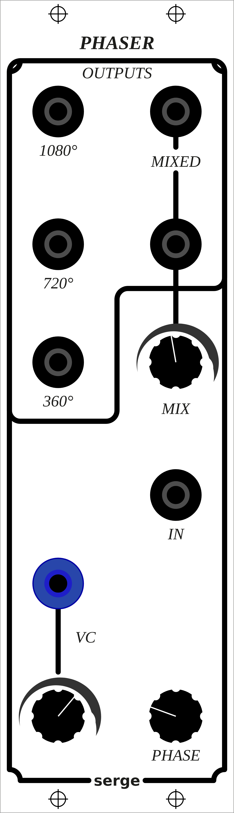 | **[VC Phaser](https://computerstaat.github.io/Serge-Synthesizer-Panel-art-and-design-files/Modules/vc-phaser.html)** A voltage-controlled phase shifter with three phase-shifted outputs and a built-in mix for the classic notched phasing sound. | Ken Stone (CGS), Low-Gain, Prism Circuits | [vc-phaser.csv](BOM/vc-phaser.csv) |
| 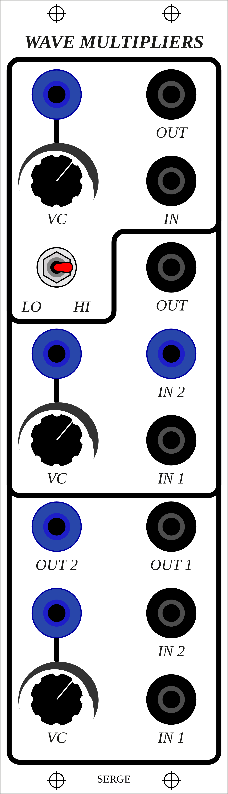 | **[Wave Multipliers](https://computerstaat.github.io/Serge-Synthesizer-Panel-art-and-design-files/Modules/wave-multipliers.html)** Three separate voltage-controlled waveshapers that add harmonics to a signal instead of filtering them away. | Ken Stone (CGS), Low-Gain | [wave-multipliers.csv](BOM/wave-multipliers.csv) |
| 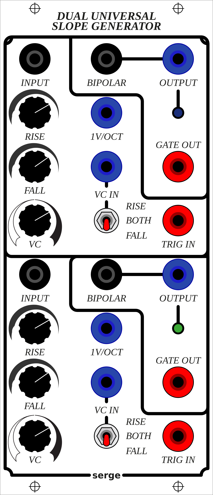 | **[Dual Universal Slope Generator](https://computerstaat.github.io/Serge-Synthesizer-Panel-art-and-design-files/Modules/dual-universal-slope-generator.html)** Two identical slope generators, each of which can be a slew limiter, envelope, LFO, audio oscillator or pulse divider. | Ken Stone (CGS), Low-Gain | [dual-universal-slope-generator.csv](BOM/dual-universal-slope-generator.csv) |
|  | **[Oscillator (1973)](https://computerstaat.github.io/Serge-Synthesizer-Panel-art-and-design-files/Modules/oscillator-1973.html)** The original paperface VCO: a sine-to-saw waveshaper under voltage control, two frequency inputs, hard sync and AC / DC outputs. | Ken Stone (CGS), Prism Circuits | [oscillator-1973.csv](BOM/oscillator-1973.csv) |
| 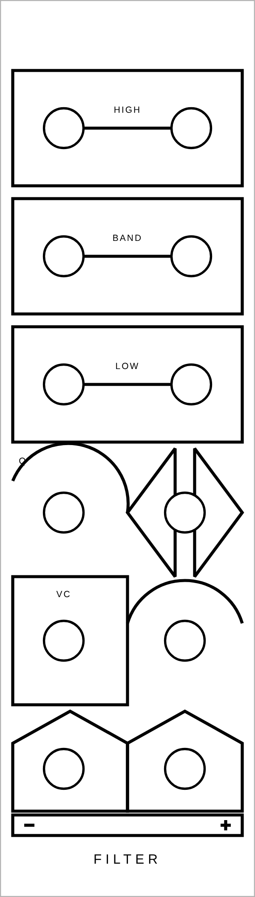 | **[VC Filter (1973)](https://computerstaat.github.io/Serge-Synthesizer-Panel-art-and-design-files/Modules/filter-1973.html)** A two-pole state-variable resonant filter with simultaneous low-pass, band-pass and high-pass outputs. | Ken Stone (CGS), Prism Circuits | [filter-1973.csv](BOM/filter-1973.csv) |
| 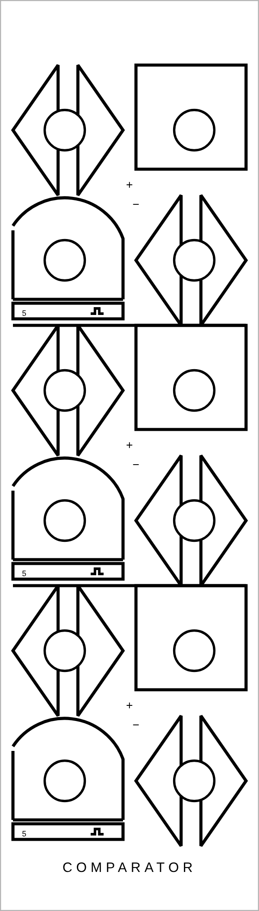 | **[Triple Comparator](https://computerstaat.github.io/Serge-Synthesizer-Panel-art-and-design-files/Modules/triple-comparator.html)** Three comparators for squaring signals, variable-width pulses, level detection and amplitude-based logic. | Ken Stone (CGS), Prism Circuits | [triple-comparator.csv](BOM/triple-comparator.csv) |
|  | **[Triple Wave Shaper](https://computerstaat.github.io/Serge-Synthesizer-Panel-art-and-design-files/Modules/triple-wave-shaper.html)** Three non-linear waveshapers that turn a sawtooth into a sine and, chained, fold waves into richer shapes. | Ken Stone (CGS), Low-Gain, Prism Circuits | [triple-wave-shaper.csv](BOM/triple-wave-shaper.csv) |
|  | **[Ring Modulator](https://computerstaat.github.io/Serge-Synthesizer-Panel-art-and-design-files/Modules/ring-modulator.html)** An AC or DC coupled ring modulator with voltage control that moves between full ring modulation and amplitude modulation. | Ken Stone (CGS), Low-Gain, Prism Circuits | [ring-modulator.csv](BOM/ring-modulator.csv) |
|  | **[Gate (1973)](https://computerstaat.github.io/Serge-Synthesizer-Panel-art-and-design-files/Modules/gate-1973.html)** An AC or DC coupled VCA with linear or log response. | Prism Circuits | [gate-1973.csv](BOM/gate-1973.csv) |
| 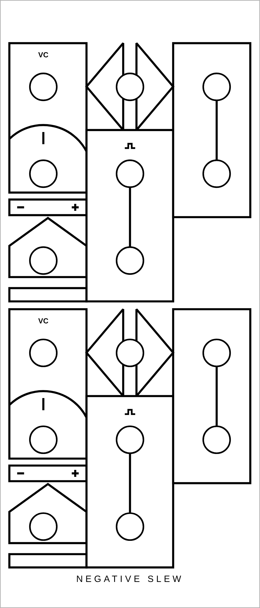 | **[Negative Slew](https://computerstaat.github.io/Serge-Synthesizer-Panel-art-and-design-files/Modules/negative-slew.html)** Two sections that slew falling voltages, and with a little patching become voltage-controlled sawtooth oscillators. | Ken Stone (CGS), Low-Gain, Prism Circuits | [negative-slew.csv](BOM/negative-slew.csv) |
| 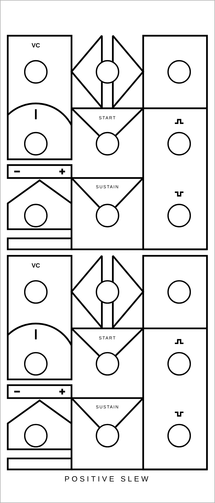 | **[Positive Slew](https://computerstaat.github.io/Serge-Synthesizer-Panel-art-and-design-files/Modules/positive-slew.html)** Two sections that slew rising voltages, or run as upward-ramp LFOs when their pulse is fed back. | Ken Stone (CGS), Low-Gain, Prism Circuits | [positive-slew.csv](BOM/positive-slew.csv) |
|  | **[Smooth & Stepped Generator](https://computerstaat.github.io/Serge-Synthesizer-Panel-art-and-design-files/Modules/smooth-stepped-generator.html)** A Smooth (slew) section and a Stepped (track-and-hold) section that couple together for random voltages, portamento and oscillators. | Ken Stone (CGS), Low-Gain, Prism Circuits | [smooth-stepped-generator.csv](BOM/smooth-stepped-generator.csv) |
| 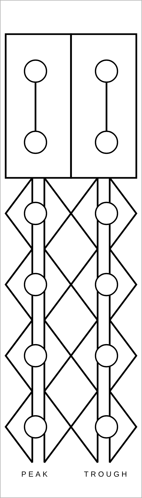 | **[Peak & Trough](https://computerstaat.github.io/Serge-Synthesizer-Panel-art-and-design-files/Modules/peak-trough.html)** Analog logic: the Peak side passes the highest of its inputs (analog OR), the Trough side the lowest (analog AND). | Ken Stone (CGS), Low-Gain, Prism Circuits | [peak-trough.csv](BOM/peak-trough.csv) |
| 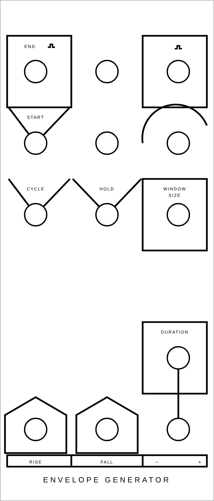 | **[Envelope Generator (1973)](https://computerstaat.github.io/Serge-Synthesizer-Panel-art-and-design-files/Modules/envelope-generator-1973.html)** A rise-and-fall envelope that always completes its cycle, with a CYCLE input for looping. | Ken Stone (CGS), Low-Gain, Prism Circuits | [envelope-generator-1973.csv](BOM/envelope-generator-1973.csv) |
|  | **[Analog Shift Register](https://computerstaat.github.io/Serge-Synthesizer-Panel-art-and-design-files/Modules/analog-shift-register.html)** A three-stage bucket-brigade sample-and-hold: each clock pulse passes every held voltage on to the next output. | Ken Stone (CGS), Prism Circuits | [analog-shift-register.csv](BOM/analog-shift-register.csv) |
|  | **[Triple Bi-Directional Router](https://computerstaat.github.io/Serge-Synthesizer-Panel-art-and-design-files/Modules/bi-directional-router.html)** Three switches that send one input to either of two outputs, or pick one of two inputs, under pulse or voltage control. | Ken Stone (CGS), Low-Gain, Prism Circuits | [bi-directional-router.csv](BOM/bi-directional-router.csv) |
| 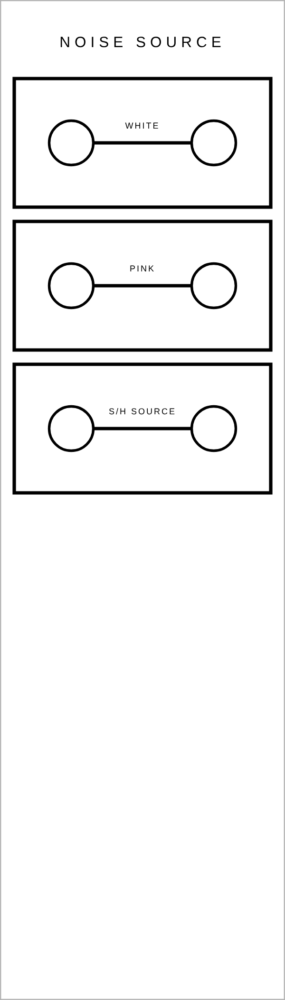 | **[Noise Source](https://computerstaat.github.io/Serge-Synthesizer-Panel-art-and-design-files/Modules/noise-source.html)** White and pink noise plus a sample-and-hold source for random voltages, triggered by pulses or a push button. | Ken Stone (CGS), Prism Circuits | [noise-source.csv](BOM/noise-source.csv) |
|  | **[Dual Processor](https://computerstaat.github.io/Serge-Synthesizer-Panel-art-and-design-files/Modules/dual-processor.html)** Two circuits that add, scale and invert control voltages, each with three inputs and a manual offset. | Ken Stone (CGS), Low-Gain, Prism Circuits | [dual-processor.csv](BOM/dual-processor.csv) |
| 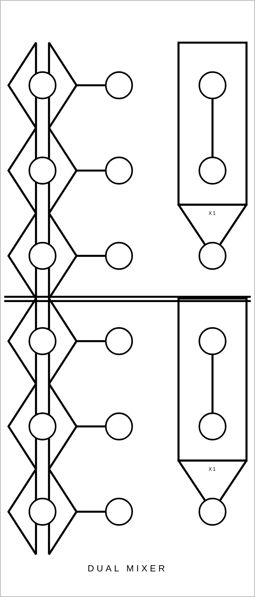 | **[Dual Mixer](https://computerstaat.github.io/Serge-Synthesizer-Panel-art-and-design-files/Modules/dual-mixer.html)** Two mixers, each with three level-controlled inputs and one unity-gain input. | Prism Circuits | [dual-mixer.csv](BOM/dual-mixer.csv) |
|  | **[Sequencer (Ten-Stage Pulse Sequencer)](https://computerstaat.github.io/Serge-Synthesizer-Panel-art-and-design-files/Modules/sequencer-10-stage.html)** A ten-stage pulse sequencer with CLOCK, RESET and HOLD inputs and a pulse output per stage. | Prism Circuits | [sequencer-10-stage.csv](BOM/sequencer-10-stage.csv) |
| 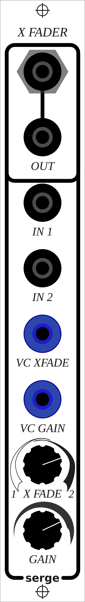 | **[X-Fader](https://computerstaat.github.io/Serge-Synthesizer-Panel-art-and-design-files/Modules/x-fader.html)** A voltage-controlled crossfader between two signals, with a built-in VCA on the result. | Prism Circuits | [x-fader.csv](BOM/x-fader.csv) |
|  | **[Gate Sequencer](https://computerstaat.github.io/Serge-Synthesizer-Panel-art-and-design-files/Modules/gate-sequencer.html)** A step sequencer of gates: each stage sends its pulse to a chosen output row. | Ken Stone (CGS), Low-Gain | [gate-sequencer.csv](BOM/gate-sequencer.csv) |
|  | **[Extended ADSR](https://computerstaat.github.io/Serge-Synthesizer-Panel-art-and-design-files/Modules/extended-adsr.html)** A voltage-controlled ADSR with an extra stage, keyboard tracking and a shape switch. | Ken Stone (CGS), Low-Gain | [extended-adsr.csv](BOM/extended-adsr.csv) |
| 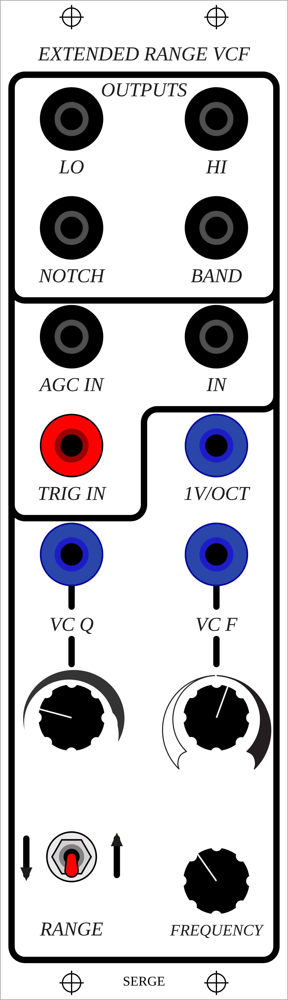 | **[Extended Range VCF / Variable Q VCF](https://computerstaat.github.io/Serge-Synthesizer-Panel-art-and-design-files/Modules/extended-range-vcf.html)** Serge's resonant voltage-controlled filter with low, high, band and notch outputs over a very wide range. | Ken Stone (CGS), Low-Gain | [extended-range-vcf.csv](BOM/extended-range-vcf.csv) |
|  | **[Resonant Equalizer](https://computerstaat.github.io/Serge-Synthesizer-Panel-art-and-design-files/Modules/resonant-equalizer.html)** A ten-band fixed filter bank whose bands can boost, cut or ring, with two comb outputs carrying alternate bands. | Ken Stone (CGS), Low-Gain | [resonant-equalizer.csv](BOM/resonant-equalizer.csv) |
| 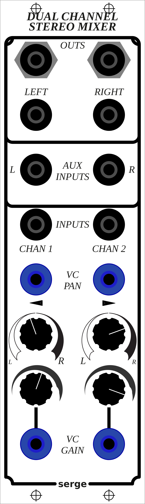 | **[Dual Channel Stereo Mixer](https://computerstaat.github.io/Serge-Synthesizer-Panel-art-and-design-files/Modules/dual-channel-stereo-mixer.html)** Two voltage-controlled channels with equal-power panning onto a stereo bus, with aux inputs for chaining mixers. | Ken Stone (CGS) | [dual-channel-stereo-mixer.csv](BOM/dual-channel-stereo-mixer.csv) |
|  | **[Programmer Sequencer](https://computerstaat.github.io/Serge-Synthesizer-Panel-art-and-design-files/Modules/programmer-sequencer.html)** A random-access voltage programmer: each stage holds a row of preset voltages and can be selected by pulse, button or up/down stepping. | Ken Stone (CGS) | [programmer-sequencer.csv](BOM/programmer-sequencer.csv) |
| 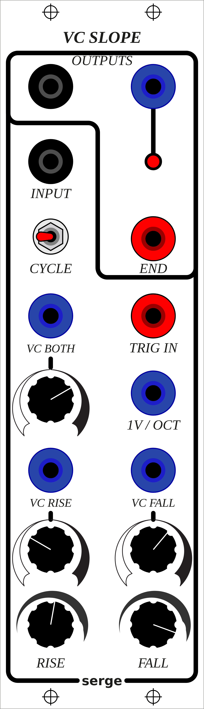 | **[VC Slope](https://computerstaat.github.io/Serge-Synthesizer-Panel-art-and-design-files/Modules/vc-slope.html)** One channel of the Serge slope generator: envelope, slew, LFO, VCO and envelope follower in a single 2" module. | Ken Stone (CGS) | [vc-slope.csv](BOM/vc-slope.csv) |
| 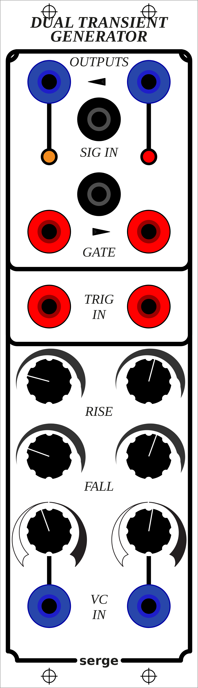 | **[Dual Transient Generator](https://computerstaat.github.io/Serge-Synthesizer-Panel-art-and-design-files/Modules/dual-transient-generator.html)** Two slope generators with voltage-controlled rise and fall: envelopes, slew, LFOs and pulse delays in 2". | Low-Gain | [dual-transient-generator.csv](BOM/dual-transient-generator.csv) |
| 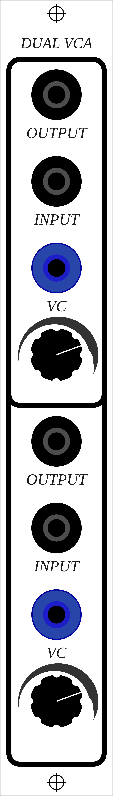 | **[Dual VCA](https://computerstaat.github.io/Serge-Synthesizer-Panel-art-and-design-files/Modules/dual-vca.html)** Two exponential VCAs for patch-level gain control, with a steep cut-off near zero volts that suits envelopes. | Low-Gain | [dual-vca.csv](BOM/dual-vca.csv) |
| 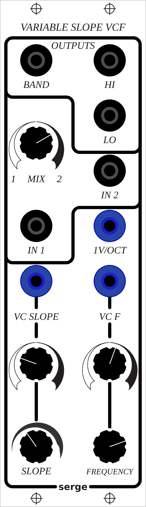 | **[Variable Slope VCF](https://computerstaat.github.io/Serge-Synthesizer-Panel-art-and-design-files/Modules/variable-slope-vcf.html)** A two-pole filter whose slope knob moves from a gentle 6 dB/octave through flat to sharp and resonant. | Low-Gain | [variable-slope-vcf.csv](BOM/variable-slope-vcf.csv) |
|  | **[Audio Mixer](https://computerstaat.github.io/Serge-Synthesizer-Panel-art-and-design-files/Modules/audio-mixer.html)** Two three-input audio mixers with level knobs, one with a phase-invert switch. | Low-Gain | [audio-mixer.csv](BOM/audio-mixer.csv) |
|  | **[Scaling Processor](https://computerstaat.github.io/Serge-Synthesizer-Panel-art-and-design-files/Modules/scaling-processor.html)** Three voltage processors with attenuverters, an offset and a +5 V source. | Low-Gain | [scaling-processor.csv](BOM/scaling-processor.csv) |
|  | **[Divide by N Comparator](https://computerstaat.github.io/Serge-Synthesizer-Panel-art-and-design-files/Modules/divide-n-comparator.html)** A comparator plus a voltage-controlled divider (1 to 31) with a staircase output. | Low-Gain | [divide-n-comparator.csv](BOM/divide-n-comparator.csv) |
|  | **[Dual Comparator](https://computerstaat.github.io/Serge-Synthesizer-Panel-art-and-design-files/Modules/dual-comparator.html)** Two comparators with threshold knobs, for squaring signals, level detection and pulse-width modulation. | Low-Gain | [dual-comparator.csv](BOM/dual-comparator.csv) |
|  | **[Active Processor](https://computerstaat.github.io/Serge-Synthesizer-Panel-art-and-design-files/Modules/active-processor.html)** A voltage-controlled crossfader plus an inverting / offset stage, for audio or control voltages. | Low-Gain | [active-processor.csv](BOM/active-processor.csv) |

## Where to get parts

- [Elby Designs](https://www.elby-designs.com/contents/en-au/d6.html): Sells the PCBs for Ken Stone's CGS designs.
- [Ken Stone (CGS)](https://open4umodular.github.io/synthpanel/modules/index.html): Schematics, parts lists, PCB overlays and construction notes for the CGS designs.
- [Prism Circuits](https://prismcircuits.net/): Paperface-style 4U PCBs (Oscillator, 1973 VCF, ASR, Router, X-Fade / Gate, Send Receive, 10-stage Sequencer and more), drilled panels and power.
- [Low-Gain](https://www.low-gain.com/): 4U Serge-format modules (Loudest Warning-style mounting), assembled or as DIY PCBs with BOMs and schematics on each product page. Some boards will not match other panel layouts, or need extra work to fit them.

Ken Stone's Serge-derived designs may be built for personal use only; Serge Tcherepnin keeps all rights to his circuits. Schematics, parts lists and PCBs belong to their designers and sellers, so these pages link to them rather than copying them.

_Generated by `_source/make_pages.py` from `_source/modules.json`._
