# Paperface

<!-- gallery:start (generated by tools/make_site.py) -->
## Panels

Click a picture for the full-size PNG. **SVG** is the artwork, **Drill** the 1:1 drill template, **Build** the module's build page. The same gallery is on the [website](https://computerstaat.github.io/Serge-Synthesizer-Panel-art-and-design-files/panels.html).

### Module (36)

<table>
<tr>
<td align="center" valign="bottom"><a href="Images/Module/Analog_Shift_Register.png">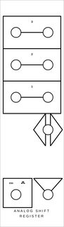</a> <b>Analog Shift Register</b> <a href="Vector%20Graphics/Module/Analog_Shift_Register.svg">SVG</a> · <a href="Drill%20Templates/Module/Analog_Shift_Register.pdf">Drill</a> · <a href="https://computerstaat.github.io/Serge-Synthesizer-Panel-art-and-design-files/Modules/analog-shift-register.html">Build</a></td>
<td align="center" valign="bottom"><a href="Images/Module/Bi-Directional_Quad-Switch.png">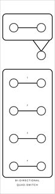</a> <b>Bi-Directional Quad-Switch</b> <a href="Vector%20Graphics/Module/Bi-Directional_Quad-Switch.svg">SVG</a> · <a href="Drill%20Templates/Module/Bi-Directional_Quad-Switch.pdf">Drill</a></td>
<td align="center" valign="bottom"><a href="Images/Module/Comparator.png">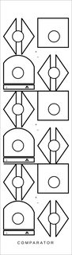</a> <b>Comparator</b> <a href="Vector%20Graphics/Module/Comparator.svg">SVG</a> · <a href="Drill%20Templates/Module/Comparator.pdf">Drill</a> · <a href="https://computerstaat.github.io/Serge-Synthesizer-Panel-art-and-design-files/Modules/triple-comparator.html">Build</a></td>
<td align="center" valign="bottom"><a href="Images/Module/Dual_Mixer.png">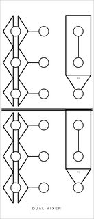</a> <b>Dual Mixer</b> <a href="Vector%20Graphics/Module/Dual_Mixer.svg">SVG</a> · <a href="Drill%20Templates/Module/Dual_Mixer.pdf">Drill</a> · <a href="https://computerstaat.github.io/Serge-Synthesizer-Panel-art-and-design-files/Modules/dual-mixer.html">Build</a></td>
<td align="center" valign="bottom"><a href="Images/Module/Dual_Mixer_4in.png">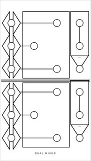</a> <b>Dual Mixer 4in</b> <a href="Vector%20Graphics/Module/Dual_Mixer_4in.svg">SVG</a> · <a href="Drill%20Templates/Module/Dual_Mixer_4in.pdf">Drill</a> · <a href="https://computerstaat.github.io/Serge-Synthesizer-Panel-art-and-design-files/Modules/dual-mixer.html">Build</a></td>
</tr>
<tr>
<td align="center" valign="bottom"><a href="Images/Module/Dual_Processor.png">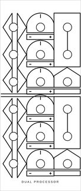</a> <b>Dual Processor</b> <a href="Vector%20Graphics/Module/Dual_Processor.svg">SVG</a> · <a href="Drill%20Templates/Module/Dual_Processor.pdf">Drill</a> · <a href="https://computerstaat.github.io/Serge-Synthesizer-Panel-art-and-design-files/Modules/dual-processor.html">Build</a></td>
<td align="center" valign="bottom"><a href="Images/Module/Dual_Sequencer.png">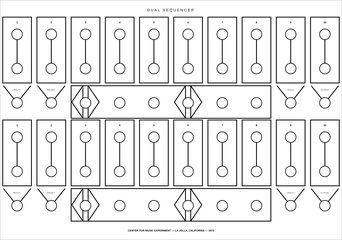</a> <b>Dual Sequencer</b> <a href="Vector%20Graphics/Module/Dual_Sequencer.svg">SVG</a> · <a href="Drill%20Templates/Module/Dual_Sequencer.pdf">Drill</a></td>
<td align="center" valign="bottom"><a href="Images/Module/Dual_XOR.png">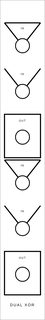</a> <b>Dual XOR</b> <a href="Vector%20Graphics/Module/Dual_XOR.svg">SVG</a> · <a href="Drill%20Templates/Module/Dual_XOR.pdf">Drill</a></td>
<td align="center" valign="bottom"><a href="Images/Module/Envelope_Generator.png">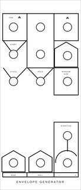</a> <b>Envelope Generator</b> <a href="Vector%20Graphics/Module/Envelope_Generator.svg">SVG</a> · <a href="Drill%20Templates/Module/Envelope_Generator.pdf">Drill</a> · <a href="https://computerstaat.github.io/Serge-Synthesizer-Panel-art-and-design-files/Modules/envelope-generator-1973.html">Build</a></td>
<td align="center" valign="bottom"><a href="Images/Module/Filter.png">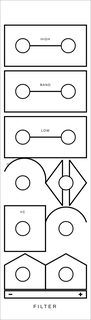</a> <b>Filter</b> <a href="Vector%20Graphics/Module/Filter.svg">SVG</a> · <a href="Drill%20Templates/Module/Filter.pdf">Drill</a> · <a href="https://computerstaat.github.io/Serge-Synthesizer-Panel-art-and-design-files/Modules/filter-1973.html">Build</a></td>
</tr>
<tr>
<td align="center" valign="bottom"><a href="Images/Module/Gate.png">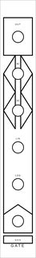</a> <b>Gate</b> <a href="Vector%20Graphics/Module/Gate.svg">SVG</a> · <a href="Drill%20Templates/Module/Gate.pdf">Drill</a> · <a href="https://computerstaat.github.io/Serge-Synthesizer-Panel-art-and-design-files/Modules/gate-1973.html">Build</a></td>
<td align="center" valign="bottom"><a href="Images/Module/Glide.png">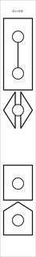</a> <b>Glide</b> <a href="Vector%20Graphics/Module/Glide.svg">SVG</a> · <a href="Drill%20Templates/Module/Glide.pdf">Drill</a></td>
<td align="center" valign="bottom"><a href="Images/Module/Hi_Gain_Amps.png">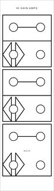</a> <b>Hi Gain Amps</b> <a href="Vector%20Graphics/Module/Hi_Gain_Amps.svg">SVG</a> · <a href="Drill%20Templates/Module/Hi_Gain_Amps.pdf">Drill</a></td>
<td align="center" valign="bottom"><a href="Images/Module/Keyboard_Envelope_Generator.png">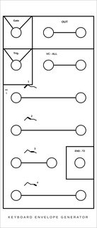</a> <b>Keyboard Envelope Generator</b> <a href="Vector%20Graphics/Module/Keyboard_Envelope_Generator.svg">SVG</a> · <a href="Drill%20Templates/Module/Keyboard_Envelope_Generator.pdf">Drill</a></td>
<td align="center" valign="bottom"><a href="Images/Module/Mixer.png">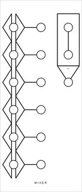</a> <b>Mixer</b> <a href="Vector%20Graphics/Module/Mixer.svg">SVG</a> · <a href="Drill%20Templates/Module/Mixer.pdf">Drill</a></td>
</tr>
<tr>
<td align="center" valign="bottom"><a href="Images/Module/Multiples.png">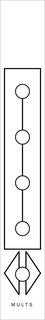</a> <b>Multiples</b> <a href="Vector%20Graphics/Module/Multiples.svg">SVG</a> · <a href="Drill%20Templates/Module/Multiples.pdf">Drill</a></td>
<td align="center" valign="bottom"><a href="Images/Module/Multiples_2in.png">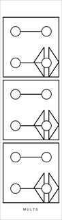</a> <b>Multiples 2in</b> <a href="Vector%20Graphics/Module/Multiples_2in.svg">SVG</a> · <a href="Drill%20Templates/Module/Multiples_2in.pdf">Drill</a></td>
<td align="center" valign="bottom"><a href="Images/Module/Multiples_B.png">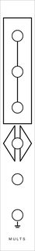</a> <b>Multiples B</b> <a href="Vector%20Graphics/Module/Multiples_B.svg">SVG</a> · <a href="Drill%20Templates/Module/Multiples_B.pdf">Drill</a></td>
<td align="center" valign="bottom"><a href="Images/Module/Negative_Slew.png">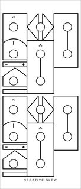</a> <b>Negative Slew</b> <a href="Vector%20Graphics/Module/Negative_Slew.svg">SVG</a> · <a href="Drill%20Templates/Module/Negative_Slew.pdf">Drill</a> · <a href="https://computerstaat.github.io/Serge-Synthesizer-Panel-art-and-design-files/Modules/negative-slew.html">Build</a></td>
<td align="center" valign="bottom"><a href="Images/Module/Noise_Source.png">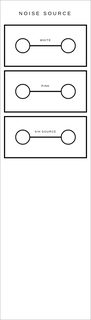</a> <b>Noise Source</b> <a href="Vector%20Graphics/Module/Noise_Source.svg">SVG</a> · <a href="Drill%20Templates/Module/Noise_Source.pdf">Drill</a> · <a href="https://computerstaat.github.io/Serge-Synthesizer-Panel-art-and-design-files/Modules/noise-source.html">Build</a></td>
</tr>
<tr>
<td align="center" valign="bottom"><a href="Images/Module/Oscillator.png">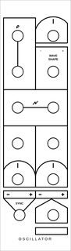</a> <b>Oscillator</b> <a href="Vector%20Graphics/Module/Oscillator.svg">SVG</a> · <a href="Drill%20Templates/Module/Oscillator.pdf">Drill</a> · <a href="https://computerstaat.github.io/Serge-Synthesizer-Panel-art-and-design-files/Modules/oscillator-1973.html">Build</a></td>
<td align="center" valign="bottom"><a href="Images/Module/Peak_Trough.png">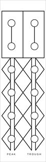</a> <b>Peak Trough</b> <a href="Vector%20Graphics/Module/Peak_Trough.svg">SVG</a> · <a href="Drill%20Templates/Module/Peak_Trough.pdf">Drill</a> · <a href="https://computerstaat.github.io/Serge-Synthesizer-Panel-art-and-design-files/Modules/peak-trough.html">Build</a></td>
<td align="center" valign="bottom"><a href="Images/Module/Phaser.png">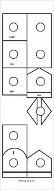</a> <b>Phaser</b> <a href="Vector%20Graphics/Module/Phaser.svg">SVG</a> · <a href="Drill%20Templates/Module/Phaser.pdf">Drill</a> · <a href="https://computerstaat.github.io/Serge-Synthesizer-Panel-art-and-design-files/Modules/vc-phaser.html">Build</a></td>
<td align="center" valign="bottom"><a href="Images/Module/Positive_Slew.png">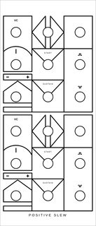</a> <b>Positive Slew</b> <a href="Vector%20Graphics/Module/Positive_Slew.svg">SVG</a> · <a href="Drill%20Templates/Module/Positive_Slew.pdf">Drill</a> · <a href="https://computerstaat.github.io/Serge-Synthesizer-Panel-art-and-design-files/Modules/positive-slew.html">Build</a></td>
<td align="center" valign="bottom"><a href="Images/Module/Programmer.png">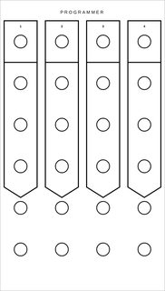</a> <b>Programmer</b> <a href="Vector%20Graphics/Module/Programmer.svg">SVG</a> · <a href="Drill%20Templates/Module/Programmer.pdf">Drill</a></td>
</tr>
<tr>
<td align="center" valign="bottom"><a href="Images/Module/Programmer_Multiples.png">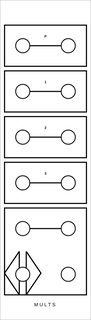</a> <b>Programmer Multiples</b> <a href="Vector%20Graphics/Module/Programmer_Multiples.svg">SVG</a> · <a href="Drill%20Templates/Module/Programmer_Multiples.pdf">Drill</a></td>
<td align="center" valign="bottom"><a href="Images/Module/Random_Voltage_Generator.png">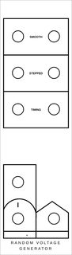</a> <b>Random Voltage Generator</b> <a href="Vector%20Graphics/Module/Random_Voltage_Generator.svg">SVG</a> · <a href="Drill%20Templates/Module/Random_Voltage_Generator.pdf">Drill</a></td>
<td align="center" valign="bottom"><a href="Images/Module/Ring.png">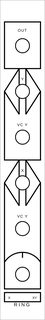</a> <b>Ring</b> <a href="Vector%20Graphics/Module/Ring.svg">SVG</a> · <a href="Drill%20Templates/Module/Ring.pdf">Drill</a> · <a href="https://computerstaat.github.io/Serge-Synthesizer-Panel-art-and-design-files/Modules/ring-modulator.html">Build</a></td>
<td align="center" valign="bottom"> <b>Schmitt Trigger</b> <a href="Vector%20Graphics/Module/Schmitt_Trigger.svg">SVG</a> · <a href="Drill%20Templates/Module/Schmitt_Trigger.pdf">Drill</a></td>
<td align="center" valign="bottom"><a href="Images/Module/Schmitt_Trigger_5_Jack.png">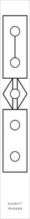</a> <b>Schmitt Trigger 5 Jack</b> <a href="Vector%20Graphics/Module/Schmitt_Trigger_5_Jack.svg">SVG</a> · <a href="Drill%20Templates/Module/Schmitt_Trigger_5_Jack.pdf">Drill</a></td>
</tr>
<tr>
<td align="center" valign="bottom"><a href="Images/Module/Sequencer.png">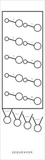</a> <b>Sequencer</b> <a href="Vector%20Graphics/Module/Sequencer.svg">SVG</a> · <a href="Drill%20Templates/Module/Sequencer.pdf">Drill</a> · <a href="https://computerstaat.github.io/Serge-Synthesizer-Panel-art-and-design-files/Modules/sequencer-10-stage.html">Build</a></td>
<td align="center" valign="bottom"><a href="Images/Module/Smooth_Stepped_Function_VC_Generator.png">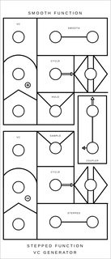</a> <b>Smooth Stepped Function VC Generator</b> <a href="Vector%20Graphics/Module/Smooth_Stepped_Function_VC_Generator.svg">SVG</a> · <a href="Drill%20Templates/Module/Smooth_Stepped_Function_VC_Generator.pdf">Drill</a> · <a href="https://computerstaat.github.io/Serge-Synthesizer-Panel-art-and-design-files/Modules/smooth-stepped-generator.html">Build</a></td>
<td align="center" valign="bottom"><a href="Images/Module/Triple_Bi-Directional_Router.png">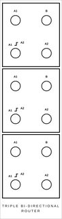</a> <b>Triple Bi-Directional Router</b> <a href="Vector%20Graphics/Module/Triple_Bi-Directional_Router.svg">SVG</a> · <a href="Drill%20Templates/Module/Triple_Bi-Directional_Router.pdf">Drill</a> · <a href="https://computerstaat.github.io/Serge-Synthesizer-Panel-art-and-design-files/Modules/bi-directional-router.html">Build</a></td>
<td align="center" valign="bottom"><a href="Images/Module/Triple_Comparator.png">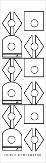</a> <b>Triple Comparator</b> <a href="Vector%20Graphics/Module/Triple_Comparator.svg">SVG</a> · <a href="Drill%20Templates/Module/Triple_Comparator.pdf">Drill</a></td>
<td align="center" valign="bottom"><a href="Images/Module/Triple_Wave_Shaper.png">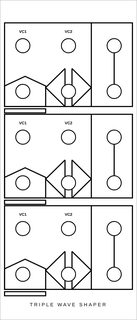</a> <b>Triple Wave Shaper</b> <a href="Vector%20Graphics/Module/Triple_Wave_Shaper.svg">SVG</a> · <a href="Drill%20Templates/Module/Triple_Wave_Shaper.pdf">Drill</a> · <a href="https://computerstaat.github.io/Serge-Synthesizer-Panel-art-and-design-files/Modules/triple-wave-shaper.html">Build</a></td>
</tr>
<tr>
<td align="center" valign="bottom"><a href="Images/Module/VC_Slew_Generator.png">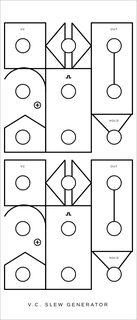</a> <b>VC Slew Generator</b> <a href="Vector%20Graphics/Module/VC_Slew_Generator.svg">SVG</a> · <a href="Drill%20Templates/Module/VC_Slew_Generator.pdf">Drill</a></td>
</tr>
</table>

### Full Panel (6)

<table>
<tr>
<td align="center" valign="bottom"> <b>CME Panel 1</b> <a href="Vector%20Graphics/Full%20Panel/CME_Panel_1.svg">SVG</a> · <a href="Drill%20Templates/Full%20Panel/CME_Panel_1.pdf">Drill</a></td>
<td align="center" valign="bottom"> <b>CME Panel 2</b> <a href="Vector%20Graphics/Full%20Panel/CME_Panel_2.svg">SVG</a> · <a href="Drill%20Templates/Full%20Panel/CME_Panel_2.pdf">Drill</a></td>
<td align="center" valign="bottom"> <b>CME Panel 3</b> <a href="Vector%20Graphics/Full%20Panel/CME_Panel_3.svg">SVG</a> · <a href="Drill%20Templates/Full%20Panel/CME_Panel_3.pdf">Drill</a></td>
</tr>
<tr>
<td align="center" valign="bottom"> <b>CME Panel 4</b> <a href="Vector%20Graphics/Full%20Panel/CME_Panel_4.svg">SVG</a> · <a href="Drill%20Templates/Full%20Panel/CME_Panel_4.pdf">Drill</a></td>
<td align="center" valign="bottom"> <b>CME Panel 5</b> <a href="Vector%20Graphics/Full%20Panel/CME_Panel_5.svg">SVG</a> · <a href="Drill%20Templates/Full%20Panel/CME_Panel_5.pdf">Drill</a></td>
<td align="center" valign="bottom"> <b>CME Panel 6</b> <a href="Vector%20Graphics/Full%20Panel/CME_Panel_6.svg">SVG</a> · <a href="Drill%20Templates/Full%20Panel/CME_Panel_6.pdf">Drill</a></td>
</tr>
</table>

<!-- gallery:end -->
