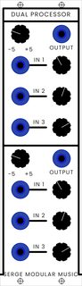
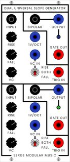
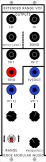
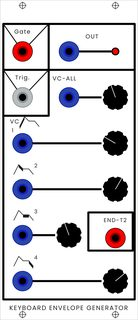
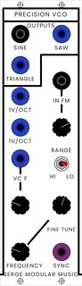
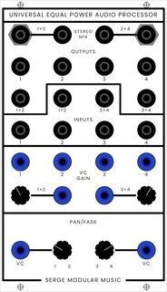

# SMMS on paper (about 1976–79): squared boxes

The older SMMS artwork, as drawn in the 1979 "Series 79" catalogue (`../../Documentation/SMMS_Catalogue_1979.pdf`):
square-cornered boxes, the module name printed inside the top of the module outline, and "serge" or
"SERGE MODULAR MUSIC (SYSTEMS)" along the bottom edge. Printed paper stuck on the panel, later with a Mylar overlay.

<!-- gallery:start (generated by tools/make_site.py) -->
## Panels

Click a picture for the full-size PNG. **SVG** is the artwork, **Drill** the 1:1 drill template, **Build** the module's build page. The same gallery is on the [website](https://computerstaat.github.io/Serge-Synthesizer-Panel-art-and-design-files/panels.html).

### Module (6)

<table>
<tr>
<td align="center" valign="bottom"> <b>Dual Processor</b> <a href="Vector%20Graphics/Module/Dual_Processor.svg">SVG</a> · <a href="Drill%20Templates/Module/Dual_Processor.pdf">Drill</a></td>
<td align="center" valign="bottom"> <b>Dual Universal Slope Generator</b> <a href="Vector%20Graphics/Module/Dual_Universal_Slope_Generator.svg">SVG</a> · <a href="Drill%20Templates/Module/Dual_Universal_Slope_Generator.pdf">Drill</a></td>
<td align="center" valign="bottom"> <b>Extended Range VCF</b> <a href="Vector%20Graphics/Module/Extended_Range_VCF.svg">SVG</a> · <a href="Drill%20Templates/Module/Extended_Range_VCF.pdf">Drill</a></td>
<td align="center" valign="bottom"> <b>Keyboard Envelope Generator UNFINISHED</b> <a href="Vector%20Graphics/Module/Keyboard_Envelope_Generator_UNFINISHED.svg">SVG</a> · <a href="Drill%20Templates/Module/Keyboard_Envelope_Generator_UNFINISHED.pdf">Drill</a></td>
<td align="center" valign="bottom"> <b>Precision VCO</b> <a href="Vector%20Graphics/Module/Precision_VCO.svg">SVG</a> · <a href="Drill%20Templates/Module/Precision_VCO.pdf">Drill</a></td>
</tr>
<tr>
<td align="center" valign="bottom"> <b>Universal Equal Power Audio Processor</b> <a href="Vector%20Graphics/Module/Universal_Equal_Power_Audio_Processor.svg">SVG</a> · <a href="Drill%20Templates/Module/Universal_Equal_Power_Audio_Processor.pdf">Drill</a></td>
</tr>
</table>

<!-- gallery:end -->

The 1978 Owner's Guide (`../../Documentation/SMMS_Owners_Guide_1978.pdf`) sketches most squared modules. It
confirms the Keyboard Envelope Generator is a 3" six-row module, while the 2" modules (Precision VCO, Dual
Transient Generator, Dual Cross-Fader) and the Quad VCA sit on the usual eight rows.

## Drawn

Built with the squared style: square corners, the name on one line inside the top edge, "SERGE MODULAR MUSIC" set
into the bottom edge, upright letter-spaced geometric sans lettering (Avant Garde style), and no swoosh round the knobs. PNG in `Images/Module`, SVG in `Vector Graphics/Module`, 1:1 drill templates in
`Drill Templates/Module`.

| Module | Source |
|---|---|
| Universal Equal Power Audio Processor | Introduction book drawings, squared-box photos |
| Dual Processor | close-up photo |
| Dual Universal Slope Generator | close-up photo |
| Extended Range VCF | older layout: IN 1 / IN 2, NOTCH (AGC) behind a dashed line, TRIG, RANGE switch |
| Precision VCO | system photos (RANGE switch beside the knobs) |

The jack and knob positions follow the Modern drawings, which match the photos; only the box style and lettering
change. Details too small to read in the photos (knob range markings, exact LED positions) are left out.

In progress: `Keyboard_Envelope_Generator_UNFINISHED` (3", six rows), close to the photos but not right yet.

Seen in system photos, not drawn yet: New Timbral Oscillator, Variable Q VCF, Variable Slope VCF, Variable Bandwidth
Filter, Triple Wave Shaper, Ring, VCA, Dual Negative Slew, VC Slew Generator, Smooth Function Generator, Analog Shift
Register, Phaser. They can be added the same way (`SERGE_STYLE=squared`) once close-ups confirm their layouts.
