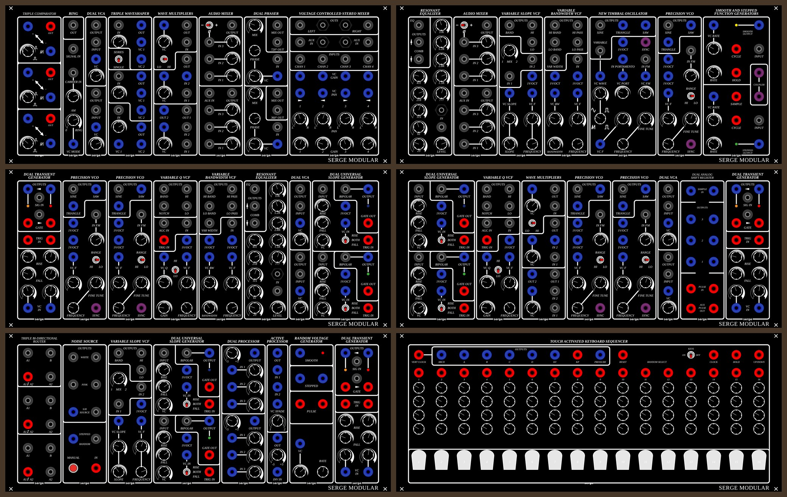

# Cal Arts Black Serge

The black-panel Serge at the California Institute of the Arts. Four 17" upright panels, a sloped control panel in front of them on the left, and a Touch Activated Keyboard Sequencer (TKB) on the right. The line-up comes from video frames and photos of the instrument, and the sloped panel was confirmed against a render of a replica.

Era: **SMMS metal overlay** (rounded-box layout), most likely early 1980s. Darrel Johansen describes donating his custom six-panel system to CalArts in 1997: built in the early 80s, with the metallic graphics exposed from positive masters so they came out silver on black instead of the usual black on silver. The drawings live in `../Modern` because the metal-overlay and STS panels share these layouts.

Each panel comes in two versions: the standard white artwork, and a black version (white lines and lettering on a black panel) that looks like the real instrument. Both use the same holes, so the drill template is shared.

## The whole system

*The whole system, drawn with the black artwork: the four upright panels (top left, top right, bottom left, bottom right), then the sloped panel and the Touch Activated Keyboard Sequencer.*

Photos of the real system:

- No public photo of the whole instrument was found; the line-up comes from video frames and photos of it.

| Panel | Modules (left to right) | White | Black | Drill |
|---|---|---|---|---|
| Top left | Triple Comparator, Ring, Dual VCA, Triple Waveshaper, Wave Multipliers, Audio Mixer, Dual Phaser, VC Stereo Mixer | [CalArts_Panel_1](../Modern/Images/Full%20Panel/CalArts_Panel_1.png) | [Black](../Modern/Images/Full%20Panel/CalArts_Panel_1_Black.png) | [PDF](../Modern/Drill%20Templates/Full%20Panel/CalArts_Panel_1.pdf) |
| Bottom left | Dual Transient Generator, Precision VCO ×2, Variable Q VCF, Variable Bandwidth VCF, Resonant Equalizer, Dual VCA, Dual Universal Slope Generator | [CalArts_Panel_2](../Modern/Images/Full%20Panel/CalArts_Panel_2.png) | [Black](../Modern/Images/Full%20Panel/CalArts_Panel_2_Black.png) | [PDF](../Modern/Drill%20Templates/Full%20Panel/CalArts_Panel_2.pdf) |
| Top right | Resonant Equalizer, Audio Mixer, Variable Slope VCF, Variable Bandwidth VCF, New Timbral Oscillator, Precision VCO, Smooth/Stepped Function Generators | [CalArts_Panel_3](../Modern/Images/Full%20Panel/CalArts_Panel_3.png) | [Black](../Modern/Images/Full%20Panel/CalArts_Panel_3_Black.png) | [PDF](../Modern/Drill%20Templates/Full%20Panel/CalArts_Panel_3.pdf) |
| Bottom right | Dual Universal Slope Generator, Variable Q VCF, Wave Multipliers, Precision VCO ×2, Dual VCA, Dual Analog Shift Register, Dual Transient Generator | [CalArts_Panel_4](../Modern/Images/Full%20Panel/CalArts_Panel_4.png) | [Black](../Modern/Images/Full%20Panel/CalArts_Panel_4_Black.png) | [PDF](../Modern/Drill%20Templates/Full%20Panel/CalArts_Panel_4.pdf) |
| Sloped (left) | Triple Bi-Directional Router, Noise Source, Variable Slope VCF, Dual Universal Slope Generator, Dual Processor, Active Processor, Random Voltage Generator, Dual Transient Generator | [CalArts_Sloped_Panel](../Modern/Images/Full%20Panel/CalArts_Sloped_Panel.png) | [Black](../Modern/Images/Full%20Panel/CalArts_Sloped_Panel_Black.png) | [PDF](../Modern/Drill%20Templates/Full%20Panel/CalArts_Sloped_Panel.pdf) |
| Sloped (right) | Touch Activated Keyboard Sequencer (TKB, 16 pads) | [TKB](../Modern/Images/Full%20Panel/Touch_Activated_Keyboard_Sequencer.png) | [Black](../Modern/Images/Full%20Panel/Touch_Activated_Keyboard_Sequencer_Black.png) | [PDF](../Modern/Drill%20Templates/Full%20Panel/Touch_Activated_Keyboard_Sequencer.pdf) |

The SVGs are in `../Modern/Vector Graphics/Full Panel/` under the same names. Front Panel Designer files are made for the white versions by the Build Kit.

Modules first drawn for this system: Triple Comparator, Dual Analog Shift Register, TKB, Noise Source, Random Voltage Generator.
